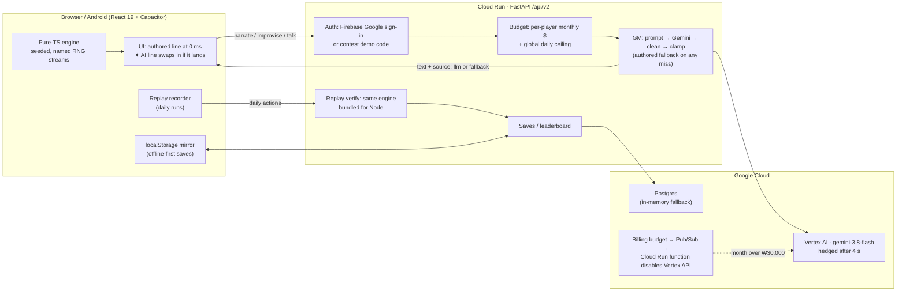

# Mythos 2.0 — Signal Run (세계:접속)

> **A deterministic cyberpunk tactics deck-builder roguelite where an LLM Game Master (Vertex AI Gemini) reacts to what you actually typed and chose — with 0 ms critical-path blocking, clamped deterministic outcomes, replay-verified daily leaderboards, and a 4-layer Google Cloud cost cap.**

- **Architecture Deep Dive (English):** [`docs/contest/architecture-en.md`](docs/contest/architecture-en.md)
- **Devpost Submission Write-Up (English):** [`docs/contest/devpost-en.md`](docs/contest/devpost-en.md)
- **Judge Pitch Summary (English):** [`docs/contest/pitch-en.md`](docs/contest/pitch-en.md)
- **Gameplay & Rules:** [`docs/GAMEPLAY.md`](docs/GAMEPLAY.md) · **Android (Capacitor):** [`docs/android.md`](docs/android.md)

---

## Cloud & AI Architecture



### Engineering Highlights

1. **AI Off the Critical Path (`src/mythos_ui/src/v2/ui/shell/gm.ts`):** Every screen renders authored prose at **0 ms**. If Vertex AI Gemini responds within budget, the line swaps in with a `✦ AI` badge (`ui/components/AiMark.tsx`). If a call times out or the player is offline, play continues with zero spinners.
2. **The Model Never Decides Mechanical Outcomes (`src/mythos_v2/gm.py`, `npc.py`):**
   - **Free-Text Improvise:** Players type any action in an event; Gemini classifies it into 1 of 5 stats, a difficulty clamped to **DC 3–9**, 1 reward from 5 fixed tiers, and 1 risk from 3. The pure-TS engine rolls the check.
   - **Grounded NPC Dialogue:** Players speak to 18 district NPCs in their own words; the NPC replies in character and Gemini maps the utterance onto one of the node's open d20 intents (9 kinds).
3. **Tail-Latency Hedging (`src/mythos_v2/llm.py`):** Scene narration fires one hedged retry after `MYTHOS_V2_GM_HEDGE_S = 4.0 s` (first response wins), cutting Vertex tail `504 DEADLINE_EXCEEDED` misses while charging late tokens from the losing leg via `on_late_usage`.
4. **Four-Layer FinOps Cost Governance (`src/mythos_v2/budget.py`, `scripts/ops/vertex_cap/`):**
   - Per-player monthly allowance ($0.30 free / $1.50 plus; ~**$0.048 per full 3-act run** across ~63 calls).
   - Global daily ceiling ($20/day; free tier degrades to authored text past 70% utilization).
   - Project billing kill-switch (₩30,000/month Cloud Billing budget → Pub/Sub → Cloud Run function disables `aiplatform.googleapis.com`).
   - Zero-cost anonymous play (₩0 model spend without sign-in or a judge `?demo=` code).
5. **Trust Without a Game Server (`src/mythos_ui/src/v2/engine/streams.ts`, `src/mythos_v2/replay.py`):**
   - Pure TypeScript engine with zero `Math.random` calls and isolated **named RNG streams** (`map@a1`, `reward@a1:n2`, `combat@.../shuffle`, `ai`).
   - Daily runs record committed actions; Cloud Run replays them in Node (`replay_verify.mjs`) to verify leaderboard submissions.
6. **Live Architect HUD (`?hud=1`):** Append `?lang=en&hud=1` to inspect live GM call outcomes (`llm` / `fallback` / `local`), median latency vs. the 0 ms authored baseline, remaining budget, active seed, named RNG streams, and replay step count (`ui/components/ArchitectHud.tsx`).

---

## Quick Start

```bash
make setup                 # Create Python .venv + install npm dependencies
make api                   # Start FastAPI + built SPA at http://127.0.0.1:8000 (busy? MYTHOS_API_PORT=8010 make api)
```

- **English + Architect HUD:** open `http://127.0.0.1:8000/?lang=en&hud=1`
- **Local AI GM (optional):** uses Ollama (`OLLAMA_MODEL_STORY=gemma4:8b-64k make api`); falls back to authored prose automatically when Ollama is off.
- **Local Postgres + API:** `make dev-up` (runs without Postgres via automatic in-memory fallback).
- **Frontend HMR:** `cd src/mythos_ui && npx vite` → `http://127.0.0.1:5173`

## Verification Gates

```bash
make check                 # Full gate: skills sync · doc budget · ruff/eslint · mypy --strict · vite build · 355 TS tests · 340+ Python tests
make test-v2               # Pure-TS engine, content, art & narrative tests (node --test)
make test-e2e-v2           # Headless muted browser smoke (title → setup → act intro → event → map → combat → daily replay verify)
make playthrough-quick     # Headless muted UI bot playing 5 map nodes + shop/safehouse/treasure/ending tour
make gm-eval               # 25-case bilingual GM evaluation suite (GM_EVAL_ARGS="--lang en" for the 13-case English slice)
```

## Repository Structure

| Path | Description |
|---|---|
| `src/mythos_ui/src/v2/engine` | Pure-TS game engine (seeded named RNG streams, JSON state, reducers, greedy/mixed/basic bots & simulator) |
| `src/mythos_ui/src/v2/content` | Typed bilingual (`{ko, en}`) game data: 104 cards, 29 enemies, 39 encounters, 44 implants, 68 events, 6 companions, 6 districts / 18 NPCs, 4 endings |
| `src/mythos_ui/src/v2/ui` | React 19 screens, 7×5 tactical board & animator, `✦ AI` provenance marks, `ArchitectHud`, procedural Web Audio SFX & adaptive music |
| `src/mythos_ui/android` | Capacitor Android app (`docs/android.md`) |
| `src/mythos_api` | FastAPI server (SPA static hosting, `/resources`, CORS, `/api/health`) |
| `src/mythos_v2` | `/api/v2` — Firebase Auth & demo codes, saves, replay-verified daily leaderboard, hedged Gemini GM (`gm.py`, `npc.py`, `talk.py`, `llm.py`, `budget.py`) |
| `resources/neo-seoul` | Generated 2.0 WebP art & audio loops (`scripts/v2_assets/`, verified by `art.test.ts`) |
| `docs/contest` | Judge-facing architecture (`architecture-en.md`), Devpost text (`devpost-en.md`), and pitch (`pitch-en.md`) |

---

## 한국어 안내 (Korean Summary)

정전과 감시의 도시 네오서울. 관리자 AI **IX**의 첨탑을 향해 세 개의 막을 돌파하는 1인용 **전술 덱빌딩 로그라이트**입니다.

- **전투**: 적이 다음에 칠 칸을 미리 보여 주는 7×5 보드(Into the Breach 방식). 피하고, 막고, 밀어서 적끼리 부딪히게 하거나 불길·전기 바닥·붕괴 구역(낭떠러지)으로 떨어뜨립니다.
- **빌드 & CRPG**: 프로토콜 카드 104장 + 임플란트 44종 + 동료 6명(3단계 전용 사건 체인) + 구역 6곳(18명의 NPC와 d20 대화).
- **루프 & 일일 시드**: 쓰러지면 모은 에코로 아카이브에서 해금하고 다시 접속합니다. 명명된 난수 스트림(`streams.ts`)과 서버 리플레이 검증(`replay.py`)으로 모두가 공정하게 경쟁하는 **오늘의 시드** 리더보드를 지원합니다.
- **AI GM**: 막/사건 내레이션, 직접 타이핑하는 자유 행동(`Improvise`), NPC 자유 대화, 은신처 동료 대화, 전투 중 IX/보스 통신. 미리 작성된 대사가 0ms에 먼저 렌더링되고 실제 모델 생성 대사는 `✦ AI` 마크와 함께 비차단으로 교체됩니다.

웹(Cloud Run)과 안드로이드 앱(Capacitor)으로 배포하며, 이전 1.x(AI 내레이션 루프 TRPG)는 **`1.0` 브랜치**에 보존돼 있습니다. 상세 진입 문서는 [`docs/AGENT_BRIEF.md`](docs/AGENT_BRIEF.md) → [`docs/STATUS.md`](docs/STATUS.md) → [`docs/NEXT_PLAN.md`](docs/NEXT_PLAN.md) 순서로 확인하세요.
