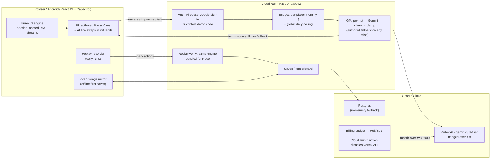

# MYTHOS 2.0 — Signal Run · architecture

*English, judge- and reader-facing. Facts as of 2026-10-25; every number points to the file or log that measured it.
Game summary and AI feature list: `docs/contest/pitch-en.md`; Devpost text: `docs/contest/devpost-en.md`; technical blog
post & conference CFP: `docs/contest/blog-and-cfp-en.md`.*

## The problem this design answers

LLM features in games usually fail in one of two ways: the game waits 5–20 s for a model, or the model's output leaks
into the rules and breaks them. Mythos is a tactics roguelite where both would be fatal — combat is a puzzle with
exact numbers, and a run lasts ~40 minutes. The architecture keeps the game fully deterministic and instant, and puts
the AI (Vertex AI Gemini) on top of it, never under it.

## Diagram

## 1 · AI off the critical path

- Every screen renders its authored text first; the model's line replaces it only if it arrives in time
  (client waits: IX 5.5 s, enemy taunt 3.5 s, boss 6 s, companion chat 11.5 s, narration and Improvise 16 s —
  `src/mythos_ui/src/v2/ui/shell/gm.ts`). A miss is invisible to the player: the authored line simply stays.
- Lines a model wrote carry a small `✦ AI` mark (authored lines carry none), are listed per run in a comms log and
  can be reported in-app (`ui/components/AiMark.tsx`, `ui/common/aiLines.ts`).
- Verified 2026-10-24 on a real model line (local Ollama): act intro + event narration both returned
  `source: llm` and showed the mark (`docs/PROGRESS_LOG.md`).

## 2 · The model never decides an outcome

- **Improvise** (type any action in an event): the model returns a stat (5), a difficulty clamped to 3–9, one reward
  from 5 and one risk from 3; an implant reward needs difficulty ≥ 7. The engine rolls it
  (`src/mythos_v2/gm.py` `DC_MIN, DC_MAX = 3, 9`, client re-clamp in `gm.ts`, engine whitelist in `engine/run.ts`).
- **NPC talk**: the NPC answers in character and the model maps the player's words to one of the node's open
  intents (9 kinds, `src/mythos_v2/npc.py`); the player then picks that option and the engine rolls a d20.
- Lines are cleaned before use: markdown, labels and any sentence stating mechanics numbers ("HP 3", "DC 7") are
  dropped (`gm.py`). Abusive input is rejected, and chat that tries to steer the model or probes for an AI is deflected to authored lines
  (`api.py` outcomes `rejected_input`, `deflected`; `talk.py` `screen_message`).

## 3 · Tail latency

- Measured 2026-10-19: the same ~100-token act intro on Vertex took 2–5 s, sometimes > 12 s or a 504
  DEADLINE_EXCEEDED (`src/mythos_v2/llm.py` docstring).
- Fix: one hedged request after `MYTHOS_V2_GM_HEDGE_S` = 4 s (or after a fast failure) on an isolated thread-local
  `AuthorizedSession`, each leg capped at 12 s HTTP timeout, plus a third recovery attempt on ≥ 10 s budgets if both
  legs return Vertex `500/504`; first success wins, and IX lines are too short-lived to hedge. Measured on Cloud Run:
  act intros answered 10/12 with hedging at 14 s vs ~50 % unhedged at 10 s. In the 13-case English `make gm-eval`
  slice (2026-10-25), local `gemma4:8b-64k` scored 100 % usable (p50 0.58 s, p95 1.08 s), and 100 % of non-500/504
  Vertex `gemini-3.8-flash` responses passed deterministic cleaning across all 13 cases (`outputs/gm-eval/`).
- The losing request's tokens are still charged to the player's budget when they arrive (`set_usage_sink`).

## 4 · Cost governance (four layers)

| Layer | Limit | Where |
| --- | --- | --- |
| Per player, monthly | $0.30 free · $1.50 higher tier (env-tunable) | `src/mythos_v2/budget.py` |
| Global, daily | $20; past 70 % of it free players go authored first | `budget.py` (`MYTHOS_V2_FREE_SHARE`) |
| Project, monthly | ₩30,000 budget → Pub/Sub → function disables `aiplatform.googleapis.com`; re-enabled next month | `scripts/ops/vertex_cap/main.py` |
| Signed out, no demo code | no model calls at all (₩0); the game is complete without AI | `api.py` `/plan` features |

Measured cost (2026-10-17, one full unassisted run): ≈ 63 model calls ≈ **$0.048 per run** at $0.75 / $3.75 per M
tokens (`bin/docs/archive/progress-2026-10-17-mythos2-ai-and-bench.md`). Spend is counted in micro-USD from the tokens
each call was billed.

## 5 · Trust without a game server

- The engine is pure TypeScript with JSON state and seeded randomness only — no `Math.random`
  (`src/mythos_ui/src/v2/engine`). Randomness is split into **named streams** (map per act; rewards, shop and events
  per node; shuffle and enemy AI per fight — `engine/streams.ts`), so on the daily seed every player meets the same
  maps and fights regardless of earlier choices.
- The client logs the committed actions of a daily run (`ui/replay/record.ts`); the server re-runs them with the
  same engine bundled for Node (`src/mythos_v2/replay.py` + `replay_verify.mjs`, 10 s timeout, 2 concurrent per
  instance) and marks the leaderboard row verified. A failed or skipped check never blocks a submit.

## 6 · Operations

- **Deploy**: `make deploy-preview` builds a no-traffic tagged revision labelled `git-sha=<HEAD>`;
  `make verify-preview` checks the label equals HEAD, health, Google sign-in, and that the served bundle is
  byte-identical to the committed one — only then is it promoted (`scripts/dev/verify_preview.py`).
- **Gates** (`make check`, 2026-10-24): 353 engine/content/UI tests (Node), 337 backend tests (Python; 12 Postgres
  tests run separately), lint + strict typing; a headless browser smoke; a UI bot that plays 5 map nodes plus a
  shop/safehouse/treasure/ending tour through real clicks (~2 min).
- **Balance**: greedy / mixed / basic bots drive a run simulator; changes are A/B'd on identical seed blocks
  (mixed-bot noise is ±6 % per block). Current baseline (3 × 360 runs): greedy ≈ 96 %, mixed ≈ 32 %, basic 0 %
  (`.claude/skills/gameplay-qa/references/qa-routes.md`).
- **Observability**: structured `v2 gm` logs per call (route, outcome, latency, provider); an opt-in Architect HUD
  (`?hud=1`) shows each call's outcome and latency live in the game (`ui/components/ArchitectHud.tsx`).

## Google Cloud services used

Cloud Run (API + SPA, preview tags), Vertex AI (Gemini), Firebase Authentication,
Firebase Cloud Messaging + Cloud Scheduler (daily-seed push), Cloud Billing budgets + Pub/Sub + a Cloud Run function
(spend cap), Cloud Logging, Firebase Crashlytics and App Distribution (Android). Saves and the leaderboard live in
Postgres (in-memory fallback when no database is configured).

## Try it

`<service URL>/?lang=en` opens in English; `&hud=1` adds the Architect HUD; a judge demo code (`&demo=<code>`, given
with the submission) turns AI lines on without an account.
