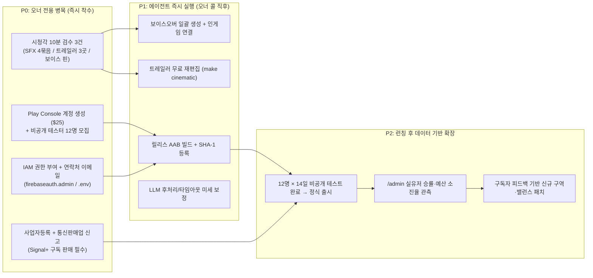

# Mythos 2.0 (세계:접속 — Signal Run) 종합 전략 분석서

작성일: 2026-10-18 · 기준 리비전: Cloud Run `00131` (`d89430d`)

본 문서는 **Mythos 2.0 (세계:접속 — Signal Run)**의 출시 직전 단계에서 **(1) 현재 작업 우선순위와 병목**, **(2) 게임의 재미(Fun) 및 시스템 깊이**, **(3) Google Cloud 운영 비용 및 Signal+ 수익성(Unit Economics)**, **(4) 실측 기반 LLM 텍스트 품질 진단 및 개선안**, **(5) 출품·수상 유망 대회 및 정부 지원사업**, **(6) 타겟 커뮤니티 및 초기 바이럴(GTM) 전략**을 종합 분석한 전략 문서다.

---

## 1. 현재 작업 우선순위 및 크리티컬 패스

현재 코드베이스는 핵심 게임플레이(전술 보드, 덱빌딩, 아카이브 메타), 온라인 인프라(Google 로그인, 클라우드 세이브, 일일 시드 리더보드, FCM 푸시), 플레이어 티어 및 예산 가드(`budget.py`, `vertex-cap`), 그리고 **Signal+ CRPG 레이어**(W0~W5: 6개 구역, d20 대화, 출신 배경, 동료 승인·캠프, 퀘스트, 생각 캐비닛, 각인, 자율도)까지 **모두 구현·검증되어 프로덕션(`00131`)에 배포 완료**된 상태다.

따라서 현재 크리티컬 패스는 추가 기능 개발이 아니라 **오너 전용 외부 절차(계정·결제·권한·시청각 검수)**에 있다.

### 1.1 P0 — 오너 전용 작업 ([docs/OWNER_TODO.md](file:///Users/men1692/Desktop/local/MythOS/docs/OWNER_TODO.md))

| 순위 | 항목 | 소요 시간 / 리드타임 | 왜 지금 해야 하는가 (병목 이유) |
| :--- | :--- | :--- | :--- |
| **1** | **Play Console 계정 생성 + 비공개 테스터 12명 모집** | 가입 후 신원 확인 수일 + **14일 연속 테스트 의무** | 신규 개인 개발자 계정은 최소 12명의 테스터가 14일 연속 옵트인해야 프로덕션 승인이 난다. 달력상 최소 2주가 고정 소요되므로 가장 먼저 시작해야 한다. |
| **2** | **사업자등록 + 통신판매업 신고 + 결제 프로필** | 홈택스/정부24 처리 약 3~7영업일 | 한국 개발자가 인앱 상품(`signal_plus_monthly`, ₩3,900)을 판매하려면 Play Console에 사업자번호와 통신판매업 신고번호를 입력해야 한다. |
| **3** | **IAM 권한 1줄 실행 + `.env` 연락처 이메일 추가** | **5분** | `mythos-run@` 서비스 계정에 `roles/firebaseauth.admin`을 부여해야 인앱 계정 삭제 시 Firebase Auth 레코드까지 완전 자동 삭제된다. |
| **4** | **SFX 4묶음 · 트레일러 3곳 · 보이스 배역 선택** | **각 10분 내외** ([sfx_trailer_prereview.md](file:///Users/men1692/Desktop/local/MythOS/docs/test/sfx_trailer_prereview.md)) | `outputs/sfx-review/index.html`, `outputs/trailer/cinematic/`, `outputs/voice-auditions/index.html`에서 오너가 확인만 해주면 에이전트가 나머지 파이프라인을 완주할 수 있다. |
| **5** | **Play Console에서 `signal_plus_monthly` 생성 + 서비스 계정 초대** | 계정·결제 프로필 완료 후 15분 | 실기기 라이선스 테스터 결제 1회를 통해 `mythos_v2/billing.py`의 `subscriptionsv2` 검증을 엔드투엔드로 최종 확인한다. |

### 1.2 P1 — 에이전트 대기 작업 (오너 피드백 즉시 수행 가능)
1. **정적 보이스오버 배치 생성 및 재생 연동**: 오너가 `pin.py` 명령을 주면 8개 배역(한국어/영어) 음성을 생성하고 UI에 연결.
2. **트레일러 재편집 (`make cinematic`)**: 오너가 지적한 컷을 Veo 재호출 없이 무료 재편집.
3. **LLM 품질·타임아웃 패치 (아래 4절 상세)**: `boss_ko` 인용부호 절단 버그 수정, 타임아웃 시 토큰 과금 누수 보정, 단문 라우트 지연 최적화.
4. **배포 패키지 생성**: 오너가 업로드 키 생성 시 `VERSION_CODE=1 make android-aab` 및 `make firebase-sha` 실행.

---

## 2. 게임의 재미(Fun) 관점 심층 분석 및 고도화 전략

### 2.1 핵심 재미 기둥 (Why Signal Run Works)

1. **완전 정보 전술 퍼즐의 손맛 (*Into the Breach* × *Slay the Spire*)**
   - 7×5 보드에서 적의 모든 공격(근접, 직선탄, 관통 광선, 돌진, 고정 포격, 회피 불가 추적 조준)이 예고된다.
   - 단순 수치 교환이 아니라 **위치 이동·밀치기(Push)·충돌 피해(Bump)·공허 낙사(Void Kill)·지면 효과(불길/전기 바닥)**를 프로토콜 카드(104장) 및 임플란트 세트(6계열 44종)와 조합해 **"절망적인 턴을 카드 2장으로 무피해 역전시키는 퍼즐적 쾌감"**이 확실하다.
2. **전술 로그라이트의 고질적 약점(서사 피로감)을 해결한 CRPG + 루프 메타**
   - 일반 덱빌딩 로그라이트는 5~10판 이후 텍스트를 모두 스킵하게 된다.
   - 반면 Mythos 2.0은 **(a) 생각 캐비닛(Thought Cabinet, 15종)**과 **각인(Echo Inscription)**으로 매 루프의 실패/성공을 서사적 패시브로 남기고, **(b) IX의 루프 기억 & 동료의 희미한 데자뷔**로 루프물 특유의 정서적 몰입을 주며, **(c) Signal+ 구역 탐색(Districts) + d20 판정 + 자유 입력 NPC 대화**를 통해 *발더스 게이트 3*나 *디스코 엘리시움* 같은 CRPG의 맛을 30분짜리 런 안에 압축했다.
3. **비차단(Off-Critical-Path) AI 아키텍처의 우월성**
   - 기존 AI 네이티브 게임들이 실패한 가장 큰 이유는 **"LLM 응답을 기다리느라 템포가 끊기고, 할루시네이션 때문에 게임 규칙이 무너진다"**는 점이다.
   - Mythos 2.0은 **작성된 문장(Authored Fallback)이 0ms에 먼저 표시**되고 AI 대사가 도착하면 자연스럽게 교체되며, 자유 행동(`improvise`)과 NPC 자유 대화(`npc.py`)는 **엔진이 허용한 클램프 범위(스탯/DC/보상/9개 의도)**로만 귀결된다. 즉, **게임으로서의 완성도와 AI의 생동감을 동시에 잡은 설계**다.

### 2.2 현재 재미의 마찰 지점(Friction)과 전략적 개선안

> [!IMPORTANT]
> **핵심 전략 제안 — 무료 유저를 위한 '1막 CRPG 에피타이저' 개방 검토 (`D8` 옵션 조정)**
> 현재 설정(`D8` 기본값)에서는 구역 탐색(District)과 d20 대화가 Signal+ 구독자에게만 열린다. 하지만 **"전술 덱빌더인데 발더스 게이트처럼 주사위를 굴리고 NPC에게 직접 말을 걸어 보스전을 바꿀 수 있다"**는 점은 이 게임의 최대 차별화 포인트이자 입소문(Viral) 포인트다. 무료 유저가 이를 전혀 보지 못하면 Signal+의 가치를 체감하기 어렵다.

| 개선 영역 | 현재 상태 및 아쉬운 점 | 구체적 재미/전환율 강화 방안 |
| :--- | :--- | :--- |
| **1. CRPG 체험 훅 (Trial Hook)** | 비구독자는 구역 탐색(🏛)·d20·NPC 자유 대화를 아예 경험할 수 없음. | **로그인 무료 유저에게 '첫 번째 루프의 1막 구역 1회' 또는 '매 런 1막 구역(자유 타이핑은 맛보기 1회)'을 개방**하고, 2·3막 구역과 캠프의 밤 심층 대화를 Signal+ 전용으로 두면 "더 해보고 싶어서 구독하는" 전환 퍼널이 강력해진다. |
| **2. 전투 시청각 타격감 (Juice)** | [sfx_trailer_prereview.md](file:///Users/men1692/Desktop/local/MythOS/docs/test/sfx_trailer_prereview.md)에서 확인되듯 경타격·강타격·폭발·벽 충돌이 유사 샘플을 공유하고, 처치와 공허 추락음이 겹침. | 전술 보드 게임에서 **밀쳐서 벽에 부딪히는 소리(둔탁한 금속 충격)**와 **공허로 떨어지는 소리(깊은 하강 잔향)**의 구분은 쾌감의 핵심이다. 오너 청취 후 해당 2개 그룹의 SFX 프로시저럴 파라미터를 분리하면 손맛이 크게 살아난다. |
| **3. '오늘의 시드' 공유 바이럴** | 일일 시드 + 일일 변형(8종) 리더보드가 완비되어 있으나 게임 외부 공유 포맷이 약함. | 일일 시드 종료 화면에 **클립보드 원클릭 공유 버튼** 추가 (예: `📡 세계:접속 Daily #1018 [유령 신호 / 유리 루프] 🏆 3막 승리 | ◈ 84 | 💥 환경처치 5 | ⏱ 21:14`). 디스코드·커뮤니티 자발적 인증샷/텍스트 공유를 유도한다. |
| **4. 퀘스트 보스전 페이오프 가시성** | 1·2막 구역 퀘스트 완수 시 보스전 변주(엄폐물 추가, 적 체력 -25% 등)가 적용됨. | 보스전 진입 순간 **"📜 [변전소 배선 거래] 효과 발동 — 해태의 냉각 노즐이 손상된 채 시작합니다"** 같은 짧은 연출 배너를 강하게 띄워주면 플레이어가 자신의 CRPG 선택이 전술 전투에 미친 영향을 확실히 체감한다. |

---

## 3. Google Cloud 운영 비용 및 수익성(Unit Economics) 분석

### 3.1 실측 기반 런당 AI 비용 ([budget.py](file:///Users/men1692/Desktop/local/MythOS/src/mythos_v2/budget.py) · [PROGRESS_LOG.md](file:///Users/men1692/Desktop/local/MythOS/docs/PROGRESS_LOG.md))

* **호출 구조**: 1회 완주 런(약 15~30분) 기준 총 **약 63회** 호출 (이벤트 15, IX 교신 26, 보스 7, 막 인트로 3, 적 도발 3, 연대기 1, 루프 시작 1, 동료 대화 6, 즉흥 행동 1).
* **토큰 소비량 (`gemini-3.8-flash`, Thinking 토큰 포함 실측 평균)**:
  * 입력 평균 ~430 tokens / 출력(Thinking 포함) 평균 ~105 tokens.
  * **현재 단가 ($0.75 / $3.75 per 1M tokens 기준)**:
    * 일반 런 1회 ≈ **$0.048 (약 ₩67)**
    * Signal+ CRPG 포함 런 1회 (구역 NPC 대화 4~6회, 캠프, 만담, 에코 추가) ≈ **$0.068 (약 ₩95)**
  * **2027년 1월 단가 2배 인상 가정 ($1.50 / $7.50 per 1M tokens)**:
    * 일반 런 1회 ≈ **$0.096 (약 ₩135)**
    * Signal+ CRPG 포함 런 1회 ≈ **$0.136 (약 ₩190)**

### 3.2 Signal+ 구독(₩3,900) 단위 경제학 (Unit Economics)

| 항목 | 금액 (KRW) | 금액 (USD, ₩1,390/$ 가정) | 비고 |
| :--- | :---: | :---: | :--- |
| **소비자 결제 금액** | ₩3,900 | $2.81 | 월 자동 갱신 구독 (`signal_plus_monthly`) |
| **부가가치세 (VAT 10%) 차감 후** | ₩3,545 | $2.55 | 한국 부가세 10% 제외 공급가액 |
| **Google Play 수수료 (15%) 차감 후 실수령액** | **₩3,013** | **$2.17** | 정기 구독 및 연매출 $1M 이하 개발자 15% 세율 적용 |
| **Signal+ 월 최대 AI 허용 한도 (`plus_usd`)** | -₩2,085 | -$1.50 | 100% 한도 소진 시 (CRPG 런 약 22판 / 2027년 기준 11판) |
| **Signal+ 평균 AI 사용 예상치** | -₩950 | -$0.68 | 월 10판 완주 기준 |
| **유료 유저 1인당 순공헌이익 (보수적~평균)** | **+₩928 ~ +₩2,063** | **+$0.67 ~ +$1.49** | **구독자 1명당 최소 31% ~ 평균 68% 공헌이익률 보장** |

> [!TIP]
> **수익성 핵심 결론: 유료 유저는 아무리 헤비하게 플레이해도 절대 적자가 나지 않는다.**
> `MYTHOS_V2_BUDGET_PLUS_USD = $1.50` 상한 덕분에 설령 유저가 한 달 내내 AI를 100% 소진하더라도 구글 수수료와 부가세를 뗀 실수령액($2.17)에서 **$0.67(약 ₩930)의 확정 흑자**가 남는다. 한도 소진 후에도 게임은 작성된 CRPG 대사와 키워드 의도 판정으로 멈춤 없이 돌아간다.

### 3.3 전체 유저 풀(무료 + 유료) 시나리오별 월간 손익 시뮬레이션

비로그인(게스트) 유저는 서버/AI 비용이 **₩0**이다. 비용이 발생하는 대상은 **Google 로그인 무료 유저(월 한도 $0.30, 평균 사용 $0.10 가정)**다.

| 시나리오 | 로그인 MAU | Signal+ 전환율 | 구독 매출 (실수령) | 무료 유저 AI 비용 | 유료 유저 AI 비용 | 인프라 고정비 (Cloud Run/DB) | **월 순이익 (영업이익)** |
| :--- | :---: | :---: | :---: | :---: | :---: | :---: | :---: |
| **초기 소프트런칭** | 300명 | 5% (15명) | ₩45,200 | -₩39,600 | -₩14,250 | ~₩5,000 | **-₩13,650** (사실상 손익분기) |
| **인디 히트 (중기)** | 2,000명 | 5% (100명) | ₩301,300 | -₩264,600 | -₩95,000 | ~₩15,000 | **-₩73,300** (무료 유저 비용 초과) |
| **인디 히트 + 최적화 적용** | 2,000명 | 7% (140명) | ₩421,820 | -₩119,500 | -₩133,000 | ~₩15,000 | **+₩154,320 (흑자 전환)** |
| **글로벌 안착 (장기)** | 10,000명 | 8% (800명) | ₩2,410,400 | -₩575,000 | -₩760,000 | ~₩45,000 | **+₩1,030,400 (안정적 흑자)** |

### 3.4 수익성을 극대화하는 3가지 기술·운영 레버

1. **무료 티어 경량 모델 라우팅 (Tiered Model Routing)**:
   - 현재 로그인 무료 유저에게도 `gemini-3.8-flash`를 서빙하고 있다.
   - 무료 유저의 호출(또는 전 티어의 단문 전투 교신 `talk:ix` / `talk:enemy`)을 **`gemini-3.5-flash-lite`**로 분리하면 호출당 비용이 **1/3 이하**로 줄어들고 응답 속도도 빨라진다(`p50 1.08s`, 에러 0%). 이렇게 하면 무료 유저가 같은 판수를 즐기더라도 무료 유저 AI 비용이 65% 이상 절감되어 **전환율 2~3%만으로도 전체 흑자**가 된다.
2. **타임아웃으로 버려진 호출의 예산 미차감 구멍 보완**:
   - 현재 [api.py](file:///Users/men1692/Desktop/local/MythOS/src/mythos_v2/api.py)에서 `ix_timeout=4.0s` 등으로 타임아웃이 발생하면, 워커 스레드의 Vertex API 호출은 끝까지 실행되어 GCP 비용이 청구되지만 `take_last_usage()`가 회수되지 않아 플레이어의 `v2_gm_spend`에는 기록되지 않는다([docs/online.md](file:///Users/men1692/Desktop/local/MythOS/docs/online.md#L128-L129)).
   - 워커 스레드가 늦게라도 완료될 때 콜백으로 `budget.charge(player_id, usage)`를 기록하도록 수정하면 유령 과금을 100% 방지할 수 있다.
3. **안전장치 이중 잠금 시 주의점 (유료 유저 보호)**:
   - 현재 11월부터 **Vertex 월 ₩30,000 자동 차단(`vertex-cap`)**이 걸려 있다.
   - 만약 유료 구독자(Signal+)가 **15명 이상** 모여서 월 실수령 매출이 ₩45,000을 넘기 시작하면, 유료 유저들이 정당하게 쓰는 AI 비용만으로도 월 ₩30,000 캡에 도달해 **돈을 낸 Signal+ 유저까지 AI가 꺼지는 상황**이 발생할 수 있다.
   - **전략**: 출시 초기(구독자 10명 미만)에는 ₩30,000 캡을 유지하되, Play Console에서 활성 구독자 수가 늘어나는 것에 비례해 `mythos-vertex-cap` 예산 임계값을 **`₩30,000 + (활성 구독자 수 × ₩2,000)`** 공식으로 상향 조정해야 한다.

---

## 4. LLM 텍스트 품질 진단 및 고도화 전략

`make gm-eval`로 측정된 최신 평가 리포트([20261018-060258-ollama_gemma4_8b-64k.json](file:///Users/men1692/Desktop/local/MythOS/outputs/gm-eval/20261018-060258-ollama_gemma4_8b-64k.json) 및 [20261018-061318-gemini_gemini-3.8-flash.json](file:///Users/men1692/Desktop/local/MythOS/outputs/gm-eval/20261018-061318-gemini_gemini-3.8-flash.json))의 실제 출력물을 정밀 비교한 결과다.

### 4.1 모델별 텍스트 품질 비교 (`gemma4:8b-64k` vs `gemini-3.8-flash`)

| 평가 차원 | 로컬 `gemma4:8b-64k` | 프로덕션 `gemini-3.8-flash` | 품질 격차 진단 |
| :--- | :--- | :--- | :--- |
| **감각 묘사 및 한국어 문장력** | *"축축한 금속 냄새가 코끝을 찌른다... 모퉁이에서 규칙적인 군화 소리가 맴돌며 멈춘다."* (무난하고 깔끔하나 상투적 표현 반복) | *"찢어질 듯 울리던 붉은 경보등이 힘없이 꺼지고 침묵이 내려앉는다. 세린의 떨리는 손끝 너머로, 다가오던 군화 소리가 엉뚱한 복도를 향해 멀어진다. 어두워진 변전함 내부에서 식어가는 회로의 메케한 탄내만 감돈다."* | **Gemini 압도적 우위.** 시각·청각·후각의 입체적 결합과 한국어 어휘 선택("메케한 탄내", "짓이기며")이 상용 CRPG 작가 텍스트에 준함. |
| **동료 페르소나 + 컨텍스트 융합 (`companion_han_dejavu_ko`)** | *"뭔 소리야, 네 기억이 또 오류 난 거 아냐? 야, 그냥 분위기 잡지 말고, 저거 터진 드론들 얘기나 하자. 쩔었지?"* (데자뷔 지시를 '기억 오류'로 직설 처리) | *"야, 내 얼굴이 흔한 타입은 아닌데 벌써 잊어먹었냐? 솔직히 방금 그 드론 박살 낼 때도 그렇고, 너랑 이러고 있으면 묘하게 예전부터 알던 사이 같긴 해. IX 놈들 장부에 없는 내 존재를 네가 그렇게 알아봐 주면 나야 땡큐지, ㅋㅋ."* | **Gemini 완승.** (1) 한의 까불거리는 해커 말투, (2) 최근 전투 로그(`드론 박살`), (3) 로어 규칙(`기억은 못 하지만 묘하게 예전부터 알던 기시감`) 3가지를 한 호흡에 자연스럽게 녹여냄. |
| **IX 루프 기억 활용 (`ix_boss_start_memory_ko`)** | *"해태의 전방 경계가 확인되었습니다."* (메모리 사실인 '세 번 쓰러졌다'를 누락) | *"해태가 앞을 막았습니다. 세 번 쓰러진 기록대로 접속자님을 회수하겠습니다."* | 짧은 글자수 제한(90자) 안에서 `gemini-3.8-flash`만 과거 루프 사망 기록을 날카롭게 인용함. |
| **지연 시간 (Latency)** | `p50 = 1.58s`, `p95 = 3.31s` (매우 안정적) | `p50 = 2.81s`, **`p95 = 25.67s`** (일부 케이스 급증) | Gemini는 평상시 1.4~3.5초로 빠르나, 특정 프롬프트에서 내부 추론(Thinking)이나 서버 지연으로 19~27초 스파이크 발생. |

### 4.2 실측 로그에서 발견된 3가지 구체적 결함 및 즉시 수정안

1. **[버그] `boss_ko` 대사 내 인용부호 절단 현상**
   - **증거** ([20261018-061318-gemini_gemini-3.8-flash.json#L217-L218](file:///Users/men1692/Desktop/local/MythOS/outputs/gm-eval/20261018-061318-gemini_gemini-3.8-flash.json#L217-L218)):
     - 모델 원문(`raw`): `깨진 아스팔트를 짓이기며 육중한 기계 신수가 안개 속에서 모습을 드러낸다. 흉골 사이의 푸른 노즐이 날카로운 파열음을 내며 눈부신 섬광을 머금기 시작한다. "미등록 개체 식별. 광역 소거를 시작한다."`
     - 클리너 통과본(`line`): `...눈부신 섬광을 머금기 시작한다. "미등록 개체 식별.` (뒤 문장이 잘리고 여는 따옴표만 남음)
   - **원인**: [gm.py](file:///Users/men1692/Desktop/local/MythOS/src/mythos_v2/gm.py)의 `narrate_limits("boss", "ko")`가 `max_sentences=3`인데, 모델이 묘사 2문장 + 인용구 속 2문장(총 4문장)을 생성하자 3번째 문장에서 강제 절단하면서 인용구가 반토막 남.
   - **해결책**: `boss` 프롬프트에 `"보스의 대사를 따옴표로 직접 인용하지 말고 외형과 전조만 묘사한다"`를 명시하거나, `clean_narration`에서 문장 절단 후 닫히지 않은 따옴표(`"`, `“`)가 포함된 조각은 마저 닫거나 해당 불완전 문장을 제거하도록 수정.
2. **[지연] `improvise` 및 `ix` 라우트의 Tail Latency (8~25초) 대책**
   - **증거**: `gemini-3.8-flash`에서 `improvise_hack_ko`가 23.3~25.6초, `ix_boss_start_memory_ko`가 7.9~8.1초 소요됨. 프로덕션 타임아웃(`improvise=12s`, `ix=4s`)을 초과하여 실제 게임에서는 폴백 처리됨.
   - **해결책**:
     - **프리페치(Prefetch) 확대**: 이미 이벤트 오프닝에 적용된 프리페치처럼, 지도에서 **보스/엘리트 노드를 클릭하는 순간(또는 전투 인트로 연출 시작 순간)** `ix_boss_start` / `elite_start` 요청을 선발송하고, 보스 체력이 60% 이하로 내려가면 `enemy` 도발 대사를 백그라운드에서 미리 준비해 둔다.
     - **`improvise` 프롬프트 경량화**: JSON 스키마 출력 시 Gemini 3.8이 불필요하게 긴 내부 추론(Thinking)을 수행하는 경향이 있으므로, `improvise` 시스템 프롬프트에 `"긴 추론 없이 즉시 한 줄 JSON만 출력하라"` 지시를 보강하고 `ix_timeout`을 4.0초 → 5.5초로 조정.
3. **[반복성] 감각 어휘("축축한", "코끝을 찌른다", "군화 소리") 클리세 제어**
   - 여러 이벤트에서 모델이 사이버펑크 기본 클리세("축축한 습기", "타는 냄새가 코끝을 찌른다", "네온사인")를 첫 문장에 반복 사용하는 경향이 있음.
   - **해결책**: `gm.py`의 이벤트/막 인트로 시스템 프롬프트에 구역별 감각 팔레트(1막: 정전·건조한 스파크·비상벨 / 2막: 야시장 인파·요리 연기·냉각수 / 3막: 무균실·백색 소음·유리 반사광)를 분기 주입하면 막(Act)별 문학적 톤앤매너가 훨씬 선명하게 갈라진다.

---

## 5. 출품·수상 유망 대회, 페스티벌 및 정부 지원사업

Mythos 2.0은 **(1) 검증된 순수 게임성(Into the Breach + Slay the Spire)**과 **(2) 안전하게 통제된 생성형 AI 기술(Vertex Gemini + Clamped Improvise/NPC Intent)**을 모두 갖추고 있어, **인디게임 어워드**와 **AI/클라우드 기술 경진대회** 양쪽 트랙을 동시에 공략할 수 있는 희소 포지션에 있다.

### 5.1 국내외 주요 대회·지원사업 로드맵

| 분류 | 대회 / 프로그램명 | 주관 / 시기 | Mythos 2.0 어필 포인트 및 기대 혜택 | 적합도 |
| :--- | :--- | :--- | :--- | :---: |
| **클라우드/스타트업** | **Google for Startups Cloud Program** | Google Cloud (상시 신청, 사업자등록 후) | Cloud Run + Vertex AI(`gemini-3.8-flash`) + Firebase + Play Billing 풀스택 활용. 선정 시 **$2,000 ~ $100,000+ GCP 크레딧** 확보로 서버/LLM 비용 수년간 0원화 가능. | ⭐⭐⭐⭐⭐ |
| **모바일/사업화** | **구글플레이 ‘창구(ChangGoo)’ 프로그램** | 구글플레이 × 중기부/창진원 (매년 봄 모집) | Google Play 독점 구독(Signal+) + Gemini API 모범 사례. 평균 **1억 원 내외 사업화 자금** + 구글 마케팅/해외 진출 패키지 지원. | ⭐⭐⭐⭐⭐ |
| **정부 R&D/제작** | **KOCCA 인공지능(AI) 게임콘텐츠 제작지원 / 인디게임 지원** | 한국콘텐츠진흥원 (매년 1~3월 공고) | "비차단(Off-critical-path) AI GM + 자유 발화 의도 매핑(`npc.py`) + 비용 한도 아키텍처"는 KOCCA AI 트랙이 가장 선호하는 **'상용화 가능한 AI 게임'** 모델. (수천만~수억 원 지원) | ⭐⭐⭐⭐⭐ |
| **국내 인디 공모전** | **GIGDC (글로벌 인디 게임제작 경진대회)** | 문체부 / KOCCA / KGDA (매년 4~6월 접수) | 국내 최고 권위 인디 공모전(일반부 제작 부문). 웹 브라우저 즉시 시연 + 안드로이드 빌드 완비로 심사위원 평가에 매우 유리. | ⭐⭐⭐⭐⭐ |
| **국내 인디 공모전** | **인디크래프트 (INDIECRAFT)** | 성남시 / 성남산업진흥원 / KMGA (매년 봄 접수) | 사업화 지원금, 글로벌 퍼블리싱 멘토링, G-STAR/플레이엑스포 공동관 전시 지원. | ⭐⭐⭐⭐ |
| **국내 인디 쇼케이스** | **BIC (부산인디커넥트페스티벌)** & **버닝비버** | BIC 조직위 (여름) / 스마일게이트 스토브인디 (연말) | 한국 대표 인디 페스티벌. 오프라인 부스에서 **"직접 타이핑해서 위기를 넘기는 즉흥 행동(Improvise)"**은 관람객 시연 효과가 극대화됨. | ⭐⭐⭐⭐⭐ |
| **글로벌 어워드** | **Google Play Indie Games Festival / Accelerator** | Google Play (권역별 개최) | Google 생태계(Vertex Gemini + Play Billing + Android)를 가장 정석적으로 쓴 인디게임으로 구글의 공식 피처드(Featured) 및 쇼케이스 선정 확률이 높음. | ⭐⭐⭐⭐⭐ |
| **글로벌 쇼케이스** | **IGF (Independent Games Festival)** / **Day of the Devs** | GDC 연계 (가을 접수) / 연중 | *Excellence in Design* 및 *Excellence in Narrative* 부문. "결정론적 전술 엔진과 반응형 AI 서사의 결합"을 디자인 노트로 제출. | ⭐⭐⭐⭐ |

---

## 6. 타겟 커뮤니티 및 Go-To-Market (초기 바이럴) 전략

인디게임 마케팅에서 가장 중요한 원칙은 **"AI 게임"이라고 먼저 외치지 않고, "전술 덱빌딩 퍼즐 + 발더스 게이트식 선택/대화 게임인데 AI가 이를 뒷받침한다"고 포지셔닝하는 것**이다.

### 6.1 1단계: Play 스토어 비공개 테스터(12명+) 즉시 확보 및 초기 팬덤 구축

| 채널 | 성격 및 타겟 | 접근 전략 및 게시물 포맷 |
| :--- | :--- | :--- |
| **스토브 인디 (STOVE Indie) '슬기로운 데모생활'** | 국내 최고 밀도의 인디게임 코어 테스터 풀 | 웹/PC 빌드 또는 안드로이드 테스트로 데모 등록. 한국 인디 게이머들이 수백 건의 상세 피드백을 남겨주며, **Play 스토어 12명 비공개 테스터 모집**을 가장 빠르게 달성할 수 있다. |
| **GeekNews (긱뉴스) `Show GN`** | 한국 개발자·IT 얼리어답터 커뮤니티 | *"순수 TypeScript 결정론적 전술 덱빌더 엔진 위에 런당 60원짜리 비차단 AI GM을 올린 1인/소규모 개발기"*로 기술 아키텍처를 공유하고 웹 플레이 링크 + 안드로이드 테스터 신청 폼을 함께 게시. |
| **인디라 (네이버 카페) / 미니맵 (Minimap)** | 국내 인디게임 개발자 및 게이머 | 네오서울 세계관 아트(해태, 야시장)와 7×5 보드 연쇄 충돌 클립을 앞세운 개발일지 연재 + 비공개 테스터 모집. |

### 6.2 2단계: 국내외 코어 게이머 커뮤니티 공략 (정식 출시 시점)

1. **국내 게이머 커뮤니티 (디시인사이드 / 아카라이브 / 루리웹)**
   - **핵심 타겟**: **슬레이 더 스파이어 마이너 갤러리**, **인디게임 마이너 갤러리**, **로그라이크 갤러리**, **발더스 게이트 3 갤러리**.
   - **후킹 포인트 (5초 움짤/쇼츠)**:
     - *클립 1 (전술 쾌감)*: 해태 보스전에서 예고된 광선을 피하며 밀치기 카드 1장으로 적 2명을 붕괴 구역(Void)에 동시 낙사시키고 IX의 당황한 교신이 뜨는 장면.
     - *클립 2 (CRPG 자유도)*: 변전소 검문소에서 선택지 버튼 대신 직접 `"전력공사 야간 감사반인데 지금 차단기 안 내리면 폭발합니다"`라고 타이핑해 기만(Deceive) d20 주사위를 굴려 통과하는 장면.
     - *클립 3 (무설치 찍먹)*: **"설치 없이 브라우저에서 지금 바로 1막 플레이 가능"** 링크 제공 (게스트 모드는 서버 비용도 ₩0이므로 트래픽이 폭발해도 비용 리스크가 전혀 없음!).
2. **글로벌 커뮤니티 (Reddit / Hacker News / itch.io)**
   - **Hacker News (`Show HN`)**:
     - 제목 안: `Show HN: Signal Run – Into the Breach meets Slay the Spire in pure TS, with a bounded AI GM`
     - HN 유저들은 **(a) 오프라인/무음에서도 100% 돌아가는 순수 TS 엔진**, **(b) LLM 할루시네이션이 게임 상태를 오염시키지 못하게 막는 `adjudicate_llm_output` / `open_intents` 샌드박스**, **(c) 자동화된 봇 밸런스 시뮬레이터(`runSim.ts`)**에 열광한다.
   - **Reddit (`r/roguelikes`, `r/deckbuildingroguelike`, `r/IntoTheBreach`, `r/AndroidGaming`)**:
     - 서구권 게이머들의 AI 거부감을 정면 돌파하기 위해 **"Why we kept AI strictly off the critical path (and added a 100% offline/authored toggle)"**를 투명하게 설명하면 신뢰도가 급상승한다.
   - **itch.io 웹 버전 동시 공개**:
     - HTML5 웹 빌드를 itch.io에 무료 등록(오프라인/게스트 모드 기본, 하단에 Google Play 앱 및 클라우드/Signal+ 안내 배너 연결)하면 글로벌 스트리머·유튜버들이 설치 부담 없이 방송 콘텐츠로 다루기 쉬워진다.

---

## 7. 요약 실행 체크리스트 (Next Action Matrix)

1. **[에이전트 수행 및 검증 완료 (2026-10-18)]**
   - `[x]` **Q1 (무료 일반 런 1막 CRPG 구역 맛보기 개방 — `D8` 추천안 적용)**: `CrpgRunState.trial`을 도입하여 일반 런에서 비구독 플레이어도 **1막 구역 탐색과 d20 대화 판정**을 무료로 체험하도록 개방(출신 선택·2~3막 구역·캠프의 밤은 Signal+ 전용 유지).
   - `[x]` **CRPG 전투 변형(Combat Twist) HUD 배지 가시화**: 구역 대화·임무 보상으로 적용된 전투 변형(`extra_cover`, `ambush_energy`, `marked_enemies`, `weakened_boss`, `burning_front`)을 전투 상단 바(`.m2c-mod-badge`)에 즉시 표시.
   - `[x]` **Q2 (LLM 품질·지연·예산 누수 패치 완료)**: `clean_line()` 내 `_balance_quotes()`로 `boss_ko` 미종결 따옴표 버그 해결, `_ACT_SENSORY`로 1~3막 감각 디테일 주입, `improvise` 단일 행 즉시 출력 지시 추가, `ix_timeout` `4.0s → 5.5s` 상향(`api.py` + `gm.ts`), `_GMRunner` `on_late_usage=budget.charge`로 타임아웃 백그라운드 완료 건 토큰 과금 누수 차단.
   - `[x]` **원클릭 런/일일 시드 결과 공유 버튼**: `EndingScreen.tsx`에 `기록 복사` / `Copy Summary` 버튼을 추가하여 런 결과·전술 지표·일일 순위를 클립보드로 즉시 복사.
   - `[x]` **전투 이펙트(지역 화상 등) 및 사운드·보이스·트레일러 마감**: `FireBase`/`GroundFire` 마그마 균열·화염 브릿지·아지랑이·연기·백열 코어 및 유닛 상태 이펙트 대폭 강화(`docs/plans/2026-10-18-combat-fx-enhancement.md`), 겹치던 효과음 4묶음 분리·보강(`sfx.ts`), 한/영 8배역 추천 보이스 고정(`voices.json`), 트레일러 보스 자막·보이스 타이밍 로컬 `ffmpeg` 재편집 완료, Vertex Veo API 호출 전면 차단 및 오너용 Gemini 웹 수동 생성 가이드(`docs/test/veo_gemini_owner_guide.md`) 작성.
2. **[오너 남은 작업]** [docs/OWNER_TODO.md](file:///Users/men1692/Desktop/local/MythOS/docs/OWNER_TODO.md)의 **1번(Play Console 계정 + IAM 권한 1줄 + `.env` 이메일)** 및 **2번(홈택스 사업자등록 + 통신판매업 신고 → Google for Startups Cloud Program 크레딧 신청 및 Play Console 결제 프로필 + `signal_plus_monthly` 등록)** 진행.
