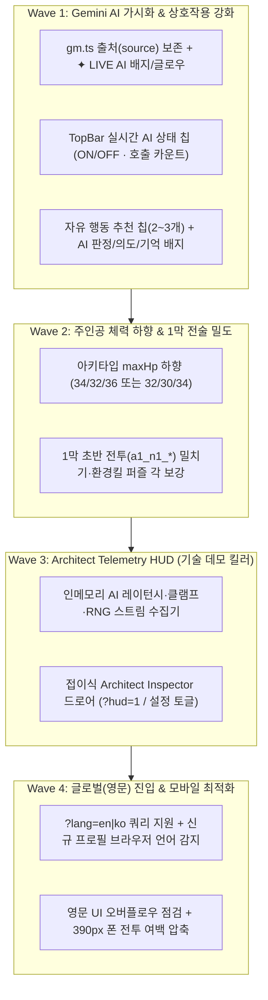

# Mythos 2.0 (세계:접속 — Signal Run) 종합 진단, 최종 개선 계획 및 방향성 추천안

작성일: 2026-10-24 · 기준 브랜치: `mythos-2.0` (프로덕션 `00140-paw` / `7707757`)
연계 문서: [2026-10-24-global-showcase-2026.md](2026-10-24-global-showcase-2026.md) · [2026-10-18-strategy-and-market-analysis.md](2026-10-18-strategy-and-market-analysis.md)

본 문서는 **Mythos 2.0 (세계:접속 — Signal Run)**의 현재 코드베이스와 실측 지표를 바탕으로 **(1) 프로젝트의 핵심 강점과 냉정한 약점**, **(2) 오너 피드백 2건("어디서 Gemini가 쓰이는지 모르겠음", "주인공 체력이 너무 많음")의 코드 원인 및 실측 기반 추천안**, **(3) 강점 극대화를 위한 4단계(Wave 1~4) 최종 실행 계획**, **(4) 향후 사용처 및 전략적 방향성**을 하나로 통합한 최종 계획서다.

---

## 1. 프로젝트 종합 진단: 강점 vs 약점

### 1.1 핵심 강점 (Why This Project Stands Out)

1. **AI 네이티브 게임의 구조적 딜레마를 해결한 `Off-Critical-Path + Clamped Sandbox` 아키텍처**
   - 대부분의 LLM 게임은 **(a) 5~20초의 응답 대기 때문에 게임 템포가 끊기거나**, **(b) 할루시네이션으로 인해 게임 규칙과 밸런스가 붕괴**한다.
   - Mythos 2.0은 모든 장면에서 **작성된 대사(Authored Fallback)를 0ms에 먼저 렌더링**하고 AI 응답이 도착하면 비차단(Non-blocking)으로 교체하며([gm.py](../../src/mythos_v2/gm.py), [IxComms.tsx](../../src/mythos_ui/src/v2/ui/shell/IxComms.tsx)), 자유 행동(`Improvise`)과 NPC 자유 대화([npc.py](../../src/mythos_v2/npc.py))는 **엔진이 허용한 고정 범위(스탯 5종, DC 3~9, 보상 5종, 위험 3종, 대화 의도 9종)** 안으로만 클램프된다.
2. **별도 게임 서버 없이 부정행위를 잡아내는 결정론적 엔진 & 리플레이 검증**
   - 순수 TypeScript 엔진([src/mythos_ui/src/v2/engine](../../src/mythos_ui/src/v2/engine))이 클라이언트에서 동작해 타일 이동·밀치기 프리뷰와 이동 되돌리기(카드를 쓰기 전까지 마지막 이동)가 즉각(0ms) 반응한다.
   - 난수를 **명명된 독립 스트림([streams.ts](../../src/mythos_ui/src/v2/engine/streams.ts))**(`map@a1`, `reward@a1:n2`, `combat@.../shuffle`, `ai`)으로 분리해 상점 방문 여부가 이후 전투 패를 바꾸지 않으며, 일일 시드 리더보드 제출 시 서버가 Node 번들로 액션 로그를 처음부터 끝까지 재실행해 검증([replay.py](../../src/mythos_v2/replay.py))한다.
3. **프로덕션급 FinOps(다중 비용 방어선)와 레이턴시 엔지니어링**
   - Vertex `gemini-3.8-flash`의 504 Tail Latency를 **요청별 타임아웃 + 4초 Hedged Retry([llm.py](../../src/mythos_v2/llm.py))**로 방어하고, 지연 완료된 백그라운드 호출의 토큰까지 회수(`on_late_usage=budget.charge`)한다.
   - 유저별 월 한도($0.30/$1.50), 일일 글로벌 상한($20, [budget.py](../../src/mythos_v2/budget.py)), 프로젝트 전체 Vertex 예산 ₩30,000 도달 시 Vertex API를 자동 차단하는 Cloud Function(`scripts/ops/vertex_cap`)까지 있다.

### 1.2 냉정한 약점 및 한계 (Weaknesses & Blind Spots)

1. **[치명적 UX 결함] 플레이어가 "지금 어디서 Gemini AI가 작동 중인지" 전혀 알 수 없음**
   - 비차단 설계가 너무 조용하게 동작하는 데다, 코드상 로컬 폴백 대사와 실제 Gemini 생성 대사가 동일한 UI로 표시되어 개발자 본인조차 어디가 AI인지 체감하기 어렵다(아래 2.1절 상세).
2. **[밸런스 결함] 주인공(접속자) 기본 체력이 과도하게 높아 초반 전술 긴장감이 죽어 있음**
   - 주인공 기본 체력(`42 / 40 / 44`)이 탱커 동료 태오(`24`)의 거의 2배에 달해, 1막에서 적의 예고 공격을 피하지 않고 맞으면서 싸워도 쉽게 클리어된다(아래 2.2절 실측 데이터 참조).
3. **[보이지 않는 기술력] 최고의 강점들이 전부 백엔드/엔진 내부에 숨어 있음**
   - Named RNG Streams, Hedged Retry, Clamped Sandbox, Replay Verification 등이 화면에 전혀 드러나지 않아, 포트폴리오/심사위원 데모에서 설명 없이는 일반 정적 웹게임처럼 보일 위험이 크다.
4. **[글로벌 진입 장벽] 신규 프로필이 무조건 한국어(`lang: 'ko'`)로 시작함**
   - 모든 콘텐츠가 `{ko, en}` 100% 이중언어임에도 URL `?lang=en`이나 브라우저 언어 감지가 없어 해외 심사위원/개발자가 첫 화면에서 이탈할 수 있다.
5. **[실유저 검증 부재 및 모바일 밀도]**
   - 현재까지의 밸런스와 UI 검증은 봇 시뮬레이터 기준이며, 폰 세로 화면(375~390px)에서 7×5 보드와 상단바(126px)·하단 카드의 정보 밀도가 다소 빡빡하다.

---

## 2. 오너 피드백 심층 진단 및 추천안

### 2.1 피드백 ①: "지금 Gemini 쓰는 AI 부분이 뭔지 모르겠어"

#### (1) 현재 게임 내 Gemini(`gemini-3.8-flash`) 실제 호출 구간 6곳 매핑

| 구분 | 인게임 화면 / 순간 | 백엔드 라우트 및 파일 | Gemini가 실제로 하는 일 |
| :---: | :--- | :--- | :--- |
| **①** | **막 인트로 (`ActIntro`)** | `POST /api/v2/gm/narrate` (`kind: 'act_intro'`, [gm.py](../../src/mythos_v2/gm.py)) | 현재 아키타입·동료·루프 회차를 반영해 막 시작 화면 좌하단 `GmCard`에 2문장 현장 묘사 생성 |
| **②** | **사건(`EventScreen`) 진입 & 선택 직후** | `POST /api/v2/gm/narrate` (`kind: 'event'`, [gm.py](../../src/mythos_v2/gm.py)) | 지도에서 노드 클릭 시 프리페치([eventOpening.ts](../../src/mythos_ui/src/v2/ui/shell/eventOpening.ts))하여 사건 좌하단 `GmCard`에 분위기/기시감 묘사 생성, 선택 후 결과 코멘트 생성 |
| **③** | **사건 화면 하단 `자유 행동 (Improvise)`** | `POST /api/v2/gm/improvise` ([gm.py](../../src/mythos_v2/gm.py)) | 플레이어가 직접 타이핑한 문장을 읽고 판정 스탯(`STR/AGI/INT/CHA/OBS`), 난이도(`DC 3~9`), 보상/위험, 성공·실패 결과 문장을 실시간 생성 |
| **④** | **구역 탐색(`DialogueScreen`) `직접 말한다`** | `POST /api/v2/gm/talk` (`mode: 'npc'`, [npc.py](../../src/mythos_v2/npc.py)) | 플레이어가 타이핑한 대사에 NPC 페르소나로 즉석 답장하고, 열려 있는 선택지의 의도(`persuade`, `deceive` 등 9종) 중 하나로 매핑 |
| **⑤** | **은신처(`RestScreen`) `동료와 대화`** | `POST /api/v2/gm/talk` (`mode: 'companion'`, [talk.py](../../src/mythos_v2/talk.py)) | 이번 루프에서 겪은 사건 로그(`run.log`)와 이전 은신처 대화를 기억해 동료 캐릭터 말투로 최대 4턴 자유 대화 |
| **⑥** | **전투 중 `IX 교신` · `보스 내레이션` · `적 도발` · `엔딩 연대기`** | `POST /api/v2/gm/talk` (`mode: 'ix' \| 'enemy'`) & `narrate` (`'boss' \| 'chronicle'`) | 보스전 시작 시 이전 루프 패배 기록(`loopMemory`) 인용, 전투 하이라이트 코멘트, 반피 적 도발, 엔딩 화면에 내가 타이핑한 자유 행동을 엮은 판 요약(연대기) 생성 |

#### (2) 왜 플레이하면서 전혀 티가 안 났는가? (코드상 근본 원인 3가지)
1. **`gm.ts`의 출처(`source`) 유실 버그**:
   - [gm.ts](../../src/mythos_ui/src/v2/ui/shell/gm.ts#L55-L67)의 `narrate()` 함수가 비로그인/오프라인/폴백 시 로컬 정적 문장([localGm.ts](../../src/mythos_ui/src/v2/ui/shell/localGm.ts))을 반환하면서 `res.source === 'llm'` 여부를 버리고 `string | null`만 반환한다.
   - (`ixLine`·`enemyTaunt`·`companionReply`는 이미 `source`를 지킨다 — IX/적 도발은 `llm`일 때만 교체하고, 동료 대화는 `source`를 돌려준다. 유실은 `narrate()` 한 곳의 문제다.)
   - 그 결과 [ActIntro.tsx](../../src/mythos_ui/src/v2/ui/shell/ActIntro.tsx#L41), [EventScreen.tsx](../../src/mythos_ui/src/v2/ui/shell/EventScreen.tsx#L144), [BossNarration.tsx](../../src/mythos_ui/src/v2/ui/shell/BossNarration.tsx#L60)가 **로컬 고정 문장까지 전부 `ai: true`로 통신 기록에 남기고**(로컬 문장에도 "AI 대사 신고" 대상 표시가 붙는다), [GmCard.tsx](../../src/mythos_ui/src/v2/ui/shell/GmCard.tsx)도 똑같이 `✨ GM · 세계:접속`으로만 렌더링한다.
2. **Silent Swap(무음 교체)으로 인한 시각적 피드백 부재**:
   - 전투 중 `IxComms`나 `EnemyTaunt`는 0ms에 고정 대사를 먼저 띄운 뒤 2~3초 후 Gemini 응답이 오면 텍스트만 조용히 바꿔치기한다. 배지나 하이라이트가 전혀 없어 눈치채기 불가능하다.
3. **현재 세션의 AI 활성화 여부가 HUD에 표시되지 않음**:
   - Google 로그인(또는 `?demo=<코드>`)이 안 되어 있으면 모든 호출이 0ms 로컬 폴백으로만 도는데, 게임 화면 상단에는 현재 AI가 켜져 있는지 꺼져 있는지 알려주는 표시가 없다.

#### (3) 추천 해결책 (Wave 1 핵심 과제로 즉시 반영)
- **`narrate()` 출처 보존 및 정직한 배지 분리**:
  - `res.source === 'llm'`으로 실제 Gemini가 생성한 대사/판정에만 선명한 시안색 **`✦ LIVE AI (Gemini)`** 배지와 등장 글로우 효과를 부여하고, 비로그인/폴백일 때는 **`로컬 기록`**으로 명확히 구분한다.
- **상단 바(`TopBar`) 실시간 AI 상태 칩**:
  - 상단 바 우측에 **`✦ AI ON (이번 루프 N회)`** 또는 **`AI OFF (로그인/데모 필요)`** 칩을 상시 노출한다.
- **자유 입력(`Improvise` / `NPC 대화`) 추천 칩 & 판정 배지**:
  - 사건마다 클릭 한 번으로 채워지는 추천 행동 칩 2~3개를 입력창 위에 제공하고, 판정 화면에 **`[✦ AI GM 판정: 지능 DC 6]`**, **`[✦ AI 의도 분석: 기만(Deceive)]`**, **`[기억 인용: 이번 루프 행적]`** 배지를 명시한다.

---

### 2.2 피드백 ②: "주인공 체력이 너무 많은 것 같음"

#### (1) 코드 및 밸런스 진단
- 현재 [archetypes.ts](../../src/mythos_ui/src/v2/content/archetypes.ts)의 주인공 기본 체력은 **유령 신호 42 / 데이터 밀수꾼 40 / 잔향 수집가 44**다.
- 반면 [companions.ts](../../src/mythos_ui/src/v2/content/companions.ts)의 동료 체력은 `18~24`(탱커인 태오가 `24`)이며, 1막 일반 적들의 공격력은 `2~5`([enemies.ts](../../src/mythos_ui/src/v2/content/enemies.ts))다.
- 즉 주인공이 탱커 동료보다 체력이 **약 1.8배** 많아, 1막에서 적의 공격 예고(붉은 타일)를 굳이 이동/밀치기로 피하지 않고 몸으로 버텨도 체력이 거의 닳지 않는다.

#### (2) `simulateRun` 실측 비교 (2026-10-24 재측정 — 블록당 120런 하나는 ±6 % 노이즈라 다블록으로 확인)

처음 측정한 블록 `1000..1119`(120런)는 그대로 재현되지만(현행 mixed 51.7 % / A 34.2 % / B 27.5 %), 이 블록은 현행 기준 **고점 이상치**다. 아래 표는 동일 시드 3블록(`100000/200000/300000 + i`, mixed 3 × 360런)과 greedy 2 × 120런, basic 60런, 아키타입은 순환 배정이다. 현재 P0 기준선(`.claude/skills/gameplay-qa/references/qa-routes.md`, 2026-10-18)은 greedy ≈ 97 % · mixed ≈ 43 % · basic 0 %이다. mixed ≈ 35 %는 10-17/18 콘텐츠 추가 전인 2026-10-11 수치다.

| 후보군 | `maxHp` (유령 / 밀수꾼 / 수집가) | Greedy 승률 (블록 1000 · 100000) | Mixed 승률 (3블록 평균, 블록 범위) | Basic | Mixed 1막 사망 (1080런 중) |
| :--- | :---: | :---: | :---: | :---: | :---: |
| **현행** | **42 / 40 / 44** | 99.2 % · 98.3 % | **44.0 %** (43.3–44.4) | 0 % | 59회 (5.5 %) |
| **추천안 A** | **34 / 32 / 36** (`-8`, 약 -19 %) | 98.3 % · 95.8 % | **32.3 %** (30.3–34.2) | 0 % | 124회 (11.5 %) |
| **추천안 B** | **32 / 30 / 34** (`-10`, 약 -24 %) | 96.7 % · 95.0 % | **29.2 %** (27.8–30.3) | 0 % | 133회 (12.3 %) |

> [!IMPORTANT]
> **추천: A (`34 / 32 / 36`)** — mixed −12 %p, 1막 사망률 약 2배, greedy는 ~97 %로 유지되며 블록 간 순위가 뒤집히지 않는다(3블록 모두 현행 > A > B). B는 A 대비 mixed −3 %p 차이뿐이고 greedy가 95 %대로 내려가며, 일일 변형 `유리 루프`(최대 HP −8) 시 최소 체력이 22까지 내려간다. 두 안 중 선택(또는 다른 값)은 오너 결정이다. 적용 후 `gameplay-qa`로 per-encounter 텔레메트리(`onFight`: 막별 HP 손실·턴 수)와 sandbox 체감을 확인한다.

---

## 3. 강점 극대화를 위한 4단계(Wave 1~4) 최종 실행 계획

### Wave 1. Gemini AI 작동 가시화 및 체감 강화 (최우선 — 완료 2026-10-24)
- `[x]` **[gm.ts](../../src/mythos_ui/src/v2/ui/shell/gm.ts) · [eventOpening.ts](../../src/mythos_ui/src/v2/ui/shell/eventOpening.ts)**: `narrateLine()` 도입(`{text, ai}`)으로 [ActIntro.tsx](../../src/mythos_ui/src/v2/ui/shell/ActIntro.tsx), [EventScreen.tsx](../../src/mythos_ui/src/v2/ui/shell/EventScreen.tsx), [BossNarration.tsx](../../src/mythos_ui/src/v2/ui/shell/BossNarration.tsx), [EndingScreen.tsx](../../src/mythos_ui/src/v2/ui/shell/EndingScreen.tsx)에서 실제 Gemini 응답(`source === 'llm'`)과 로컬 폴백을 정확히 구분.
- `[x]` **[GmCard.tsx](../../src/mythos_ui/src/v2/ui/shell/GmCard.tsx) · [IxComms.tsx](../../src/mythos_ui/src/v2/ui/shell/IxComms.tsx) · [EnemyTaunt.tsx](../../src/mythos_ui/src/v2/ui/shell/EnemyTaunt.tsx) · [CompanionChat.tsx](../../src/mythos_ui/src/v2/ui/shell/CompanionChat.tsx)**: `ai === true`일 때 **`✦ AI`** 라이브 배지 및 교체(Swap) 시 시안색 하이라이트 애니메이션 표시.
- `[-]` **[TopBar.tsx](../../src/mythos_ui/src/v2/ui/shell/TopBar.tsx)**: 오너 결정(2026-10-24 `DECISIONS.md`: UX-first, 저피로도 유지)으로 상단바 상시 칩 및 의도-%/기억 배지는 제외.
- `[x]` **[EventScreen.tsx](../../src/mythos_ui/src/v2/ui/shell/EventScreen.tsx) · [DialogueScreen.tsx](../../src/mythos_ui/src/v2/ui/shell/DialogueScreen.tsx)**:
  - 플레이어 상위 스탯에 맞는 **원탭 추천 자유 행동 칩 3개** 제공(`improvSuggest.ts`, 클릭 시 입력창에 자동 입력).
  - `Adjudication` 카드와 NPC 자유 대화 응답에 `✦ AI` 배지 및 인라인 신고 버튼 부착.

### Wave 2. 주인공 기본 체력 하향 & 1막 전투 긴장감 보강 (완료 2026-10-24/25)
- `[x]` **[archetypes.ts](../../src/mythos_ui/src/v2/content/archetypes.ts) · [content.test.ts](../../src/mythos_ui/src/v2/content/content.test.ts)**: 주인공 `maxHp`를 `42 / 40 / 44` → **`34 / 32 / 36`**(오너 선택)으로 조정하고 테스트 범위(`30 <= maxHp <= 38`)를 갱신.
- `[x]` **[encounters.ts](../../src/mythos_ui/src/v2/content/encounters.ts)**: 1막 초반 전투(`a1_n1_dodge`, `a1_n1_overpass`, `a1_n1_cover`)에서 밀치기·화염·낭떠러지 환경킬 퍼즐 구도 보강 및 동일 시드 블록(3 × 360) `simulateRun` 검증(2026-10-25: greedy 95.0 %, mixed 30.9 %, basic 0 %).

### Wave 3. 아키텍처 가시화 — `Architect Telemetry HUD` (완료 2026-10-24)
- `[x]` **`src/mythos_ui/src/v2/ui/common/telemetry.ts` · `ArchitectHud.tsx`**:
  - 최근 AI 호출의 `Route / Latency(ms) / Outcome(llm|fallback|local|off)`, 현재 `Named RNG Stream` 시드 키, `Replay Action Steps`, `Allowance`를 기록.
  - `?hud=1`로 여닫을 수 있는 비차단 인스펙터 오버레이 구현(모바일에서는 접힌 탭으로 시작).

### Wave 4. 글로벌(영문) 자동 진입 & 영문/모바일 UX 마감 (완료 2026-10-24/25)
- `[x]` **[store.ts](../../src/mythos_ui/src/v2/ui/store.ts) · [lang.ts](../../src/mythos_ui/src/v2/ui/common/lang.ts)**: `?lang=en|ko` URL 쿼리 지원 및 신규 디바이스(`mythos2.lang0`) 브라우저 언어 기반 자동 영문(`en`) 진입(오너 승인 2026-10-24).
- `[x]` **[phone.css](../../src/mythos_ui/src/v2/ui/combat/phone.css) · [layout.ts](../../src/mythos_ui/src/v2/ui/combat/screen/layout.ts) · 영문/모바일 감사**: `?lang=en&mute=1` 및 `375×667` / `390×844` / `412×915` 모바일 뷰포트에서 전투 타일 크기(`50~57px`) 및 상점/은신처 2.0 WebP 아트 패리티 마감(2026-10-25).
- `[x]` **`docs/contest/architecture-en.md` · `docs/contest/devpost-en.md`**: Wave 1~4의 실측 수치와 아키텍처 다이어그램을 포함한 영문 기술 아키텍처 및 Devpost 제출 문서 작성(2026-10-24/25).

---

## 4. 프로젝트 사용처 및 전략적 방향성 추천

> [!TIP]
> **핵심 포지셔닝 전략**:
> 겸업 이슈로 유료 인앱결제(Signal+)와 사업자등록이 보류된 현재 상황에서는, 이 프로젝트를 **"단순 인디게임"**이 아니라 **"실제 플레이 가능한 상용급 전술 게임으로 증명한 프로덕션 AI·클라우드 레퍼런스 아키텍처"**로 포지셔닝하는 것이 투자 대비 효용(ROI)이 가장 높다.

| 우선순위 | 사용처 / 타겟 트랙 | 시기 | 핵심 어필 포인트 및 활용 패키지 |
| :---: | :--- | :---: | :--- |
| **1순위** | **클라우드·AI 아키텍트 포트폴리오 & 컨퍼런스 CFP / GDE** (GDG DevFest, Cloud Next Extended, 기술 블로그) | **즉시 ~ 상시** | 5대 엔지니어링 실증 사례(Off-Critical-Path AI, 4s Hedged Retry, Micro-USD FinOps Cap, Named RNG Streams + Server Replay Verify, Bot Balance Harness) + `Architect HUD` 시연 |
| **2순위** | **글로벌 개발자 챌린지 출품** (Google Gemini / Cloud Devpost 해커톤, 개최 공고 미확인 — 공고 확인 후 확정) | **2026.12 ~ 2027.03** | 심사위원 전용 무로그인 AI 데모 링크(`<URL>/?demo=<code>&lang=en&hud=1`) + 3분 영문 아키텍처·게임플레이 영상 + `architecture-en.md` |
| **3순위** | **글로벌·국내 개발자 커뮤니티 쇼케이스** (`Show HN`, `GeekNews Show GN`, Reddit `r/roguelikes`, itch.io) | **Wave 1~4 완료 직후** | 비로그인 게스트 모드는 LLM 비용이 **₩0**(Cloud Run 호스팅비만)이고, 로그인 유저는 유저별 월 한도 + 일일 $20 상한 + 프로젝트 Vertex ₩30,000 차단이 걸려 있어 트래픽이 몰려도 LLM 과금이 제한된 채로 실유저 플레이 데이터 수집 가능 |
| **4순위** | **국내 인디게임 공모전 & 페스티벌** (IndieGo, 인디크래프트, GIGDC, BIC, 비버롹스) | **2027년 봄~여름** | 사업자등록 없이 개인 자격 출품 가능. 오프라인/심사 시연에서 직접 타이핑하는 `Improvise`와 `NPC 자유 대화`가 강력한 차별화 요소로 작동 |
| **5순위** | **상용 출시 & 창업/정부지원 트랙** (Google Play 정식 출시, 창구 프로그램, KOCCA AI 제작지원, Google for Startups 크레딧) | **향후 보류 해제 시** | 결제 검증([billing.py](../../src/mythos_v2/billing.py)), 계정 삭제/정책 페이지, 스토어 그래픽, 안드로이드 빌드가 구현되어 있음. 단 Signal+는 가짜 Play API로만 테스트됐고 상품·판매자 프로필·서비스 계정 권한이 아직 없음(`STATUS.md` Open Risks) — 보류 해제 시 실제 Play 결제 E2E 검증이 먼저 |
