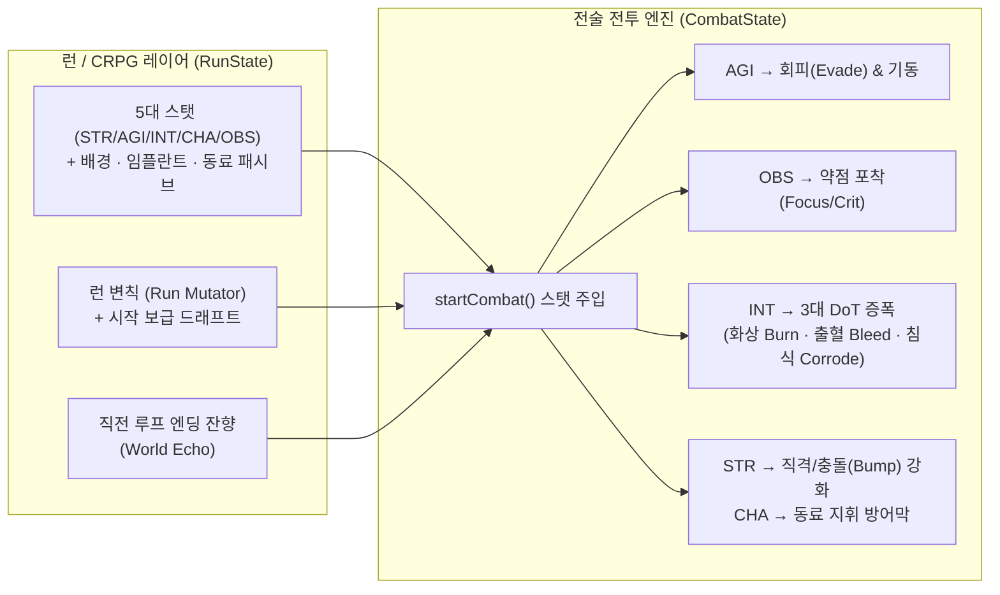

# Mythos 2.0 — 5대 스탯 전투 연동(회피·치명타), 지속 데미지(DoT) 확장 및 다회차 플레이 마스터 플랜

작성일: 2026-10-25 · 기준 브랜치: `mythos-2.0` (`80ae83f`, 프로덕션 `00144-haw`)
연계 문서: [2026-10-11-port-from-1x.md](2026-10-11-port-from-1x.md) · [2026-10-18-tiers-and-ai-narrative.md](2026-10-18-tiers-and-ai-narrative.md) · [2026-10-24-improvement-and-direction-plan.md](2026-10-24-improvement-and-direction-plan.md)

본 문서는 오너 요청에 따라 **(1) 현재 동료 6인 리스트 및 역할**, **(2) Mythos 1.0 → 2.0 포팅 현황과 미포팅 공백**, **(3) 민첩(`AGI`)·관찰(`OBS`) 등 5대 스탯의 전투 영향도(회피·치명타)와 지속 데미지(DoT)·상태이상 현황 진단**, **(4) 다회차 플레이(Replayability) 경험 확장을 포함한 4단계(Wave 1~4) 상세 구현 계획**을 정리한 설계 문서다.

---

## 1. 현황 정밀 진단 (Current State Audit)

### 1.1 현재 동료(Companions) 6인 전체 명단 및 스펙
코드 기준 정본은 [companions.ts](../../src/mythos_ui/src/v2/content/companions.ts)이며, 각 동료는 **고유 유닛 스탯(HP·이동력) + 런 패시브(비전투/스탯) + 전투 패시브(`combatPassive`) + 기본 카드 2장 + 유대(Bond 2/3) 카드 1장 + 3단계 전용 서사 이벤트([eventsArcs.ts](../../src/mythos_ui/src/v2/content/eventsArcs.ts)) + 호감도 컷신 2종([cutscenes.ts](../../src/mythos_ui/src/v2/content/cutscenes.ts))**을 보유한다.

| ID | 이름 (이명) | 역할 · 기본 해금 | HP / 이동 | 런 패시브 (`passive`) | 전투 패시브 (`combatPassive`) | 전용 카드 (기본 2 / 유대 1) |
| :--- | :--- | :--- | :---: | :--- | :--- | :--- |
| `se_rin` | **정세린** (`물거미`) | 밀수꾼 · 기동과 방어막 *(기본 해금)* | `20` / `3` | 추적 증가 `−10%`, **민첩(`AGI`) +1** | **물거미**: 세린이 전술(`tactic`) 카드를 쓰면 방어막 3 + **재이동** (턴당 1회) | `serin_water_spider` (물거미 걸음) `serin_cover_fire` (엄호 사격) **[유대]** `serin_escape_route` (탈출 루트) |
| `tae_o` | **태오** (`사냥개`) | 탈주 집행관 · 탱커/방패 *(기본 해금)* | `24` / `3` | 접속자 최대 HP `+5`, **근력(`STR`) +1** | **사냥개의 방패**: 전투 시작 시 `가시(thorns) 2`, 태오가 공격 카드를 쓰면 방어막 4 (턴당 1회) | `taeo_hound_slam` (사냥개 몸통박치기) `taeo_iron_stance` (강철 자세) **[유대]** `taeo_guardian_wall` (수호의 벽) |
| `han` | **한** (`신호 파괴자`) | 비접속자 해커 · 교란/드로우 *(기본 해금)* | `18` / `3` | 추적 증가 `−20%`, **지능(`INT`) +1** | **역추적**: 한이 전술(`tactic`) 카드를 쓰면 **카드 1장 드로우** (턴당 1회) | `han_signal_break` (신호 차단) `han_shortcut_call` (지름길 호출) **[유대]** `han_system_intrusion` (시스템 침입) |
| `su_ah` | **수아** (`기억의 대장장이`) | 잔향 가공사 · 단조와 방어막 *(아카이브 해금)* | `20` / `3` | 카드 보상 선택지 **`+1`** | **대장간 불씨**: 전투 시작 시 `잔향 칼날(echo_blade)` 1장 생성, 기술(`skill`) 카드 사용 시 전체 아군 방어막 2 | `suah_forge_blades` (칼날 벼리기) `suah_tempered_plate` (담금질 장갑) **[유대]** `suah_masterwork` (명작 단조) |
| `kai` | **카이** (`RX-09`) | 꿈꾸는 폐기 안드로이드 · 저격 *(아카이브 해금)* | `22` / `3` | **관찰(`OBS`) +2**, **근력(`STR`) +1** | **광학 조준**: 매 턴 시작 시 무작위 적 하나에 **표식(`mark`) 2** 부여 | `kai_scope_in` (조준경 고정) `kai_rx_beam` (RX 광선) **[유대]** `kai_dreamshot` (꿈의 저격) |
| `lin_yue` | **린위에** (`환전상`) | 야시장 브로커 · 자금/정밀타격 *(아카이브 해금)* | `18` / `3` | 크레딧 획득 `+20%`, 상점 가격 `−10%` | **환전 수수료**: 적 처치마다 `+3₵` 획득, 턴당 첫 처치 시 **에너지 +1** | `linyue_exchange` (환전) `linyue_precision_emp` (정밀 EMP) **[유대]** `linyue_gold_hairpin` (금비녀) |

---

### 1.2 Mythos 1.0 → 2.0 포팅 현황 및 미포팅 공백 진단
[2026-10-11-port-from-1x.md](2026-10-11-port-from-1x.md) 및 [2026-10-18-tiers-and-ai-narrative.md](2026-10-18-tiers-and-ai-narrative.md)를 통해 1.0(`1.0` 브랜치)에서 검토된 항목들의 현재 반영 상태는 다음과 같다.

#### (1) 이미 포팅 완료된 항목
- **서사/RPG**: 스탯 내면 목소리 5종([statVoices.ts](../../src/mythos_ui/src/v2/content/statVoices.ts)), 동료 호감도 컷신 12종 + 갤러리([cutscenes.ts](../../src/mythos_ui/src/v2/content/cutscenes.ts)), 동료별 런 시작 비네트([openings.ts](../../src/mythos_ui/src/v2/content/openings.ts)), 루프 각인(`Echo Inscription`) 및 자율도(`Autonomy`)([legacy.ts](../../src/mythos_ui/src/v2/engine/legacy.ts)), 사유 내각(`Thought Cabinet`)([thoughts.ts](../../src/mythos_ui/src/v2/engine/thoughts.ts)), IX의 거울([ixMirror.ts](../../src/mythos_ui/src/v2/content/ixMirror.ts)).
- **메타/시스템**: 동료 숙련도 Mastery I/II([meta.ts](../../src/mythos_ui/src/v2/engine/meta.ts)), 임플란트 태그 세트 보너스 6종([implantSets.ts](../../src/mythos_ui/src/v2/engine/implantSets.ts)), 일일 시드 변칙 8종([mutators.ts](../../src/mythos_ui/src/v2/engine/mutators.ts)), AI GM 호칭·말투 가드 및 아젠다([gm.py](../../src/mythos_v2/gm.py), [talk.py](../../src/mythos_v2/talk.py)).

#### (2) 아직 포팅되지 않았거나 반쪽만 반영된 핵심 공백 4가지

| 구분 | 1.0 원형 (`branch 1.0`) | 2.0 현재 상태 | 문제점 및 개선 필요성 |
| :--- | :--- | :--- | :--- |
| **공백 ①** **5대 스탯의 전투 연동** | `mythos_combat`에서 스탯이 공격력·회피·치명타·상태이상에 관여 | **전투 영향도 0** ([combat.ts](../../src/mythos_ui/src/v2/engine/combat.ts)가 `run.stats`를 아예 읽지 않음) | 세린(`AGI+1`), 태오(`STR+1`), 한(`INT+1`), 카이(`OBS+2`) 및 임플란트/성장으로 올린 스탯이 대화 주사위에만 쓰이고 **전술 전투에서는 아무 효과가 없음** |
| **공백 ②** **루프 변칙(`loop_modifiers`)의 일반 런 적용** | 매 루프 시작 시 도시 환경 변칙(`patrol surge`, `market boom` 등) 부여 | **일일 작전(Daily Run) 전용**으로만 격리됨 ([mutators.ts](../../src/mythos_ui/src/v2/engine/mutators.ts)) | 일반 다회차 런에서는 회차마다 전술/경제 규칙이 바뀌는 변칙 경험이 없음 |
| **공백 ③** **다중 상태이상 / 지속 데미지(DoT) 깊이** | `status_rules.py`에 다중 디버프/중첩 규칙 존재 | DoT가 **`burn`(화상) 단 1종**뿐 ([types.ts](../../src/mythos_ui/src/v2/engine/types.ts#L70)) | 기동/밀치기 연계형 DoT(출혈)나 장갑 파쇄·전염형 DoT(침식)가 없어 지속 피해 덱 빌드가 단조로움 |
| **공백 ④** **용어 툴팁 칩(#20) & 보이스오버(#21)** | `glossary.ts` / `termGloss.ts`, `voices.json` | 용어 칩 미포팅, 음성은 오디션 클립 생성 및 후보 핀까지만 완료 | 세계관 핵심 용어 인라인 설명 부재, 보이스오버는 추후 오너 청취/승인 시 연결 가능 |

---

### 1.3 스탯 영향도(회피·크리) 및 지속 데미지(DoT) 코드 수준 진단

1. **5대 스탯 (`STR` 근력 / `AGI` 민첩 / `INT` 지능 / `CHA` 화술 / `OBS` 관찰)**
   - 정의: [types.ts](../../src/mythos_ui/src/v2/engine/types.ts#L29-L30) (`StatKey = 'str' | 'agi' | 'int' | 'cha' | 'obs'`, 값 범위 `1 ~ 10`).
   - 현재 사용처:
     - 사건 선택지 주사위 판정 및 CRPG 지구 대화 d20 판정 ([run.ts](../../src/mythos_ui/src/v2/engine/run.ts), [crpg.ts](../../src/mythos_ui/src/v2/engine/crpg.ts))
     - 스탯 내면 목소리 출력 ([statVoices.ts](../../src/mythos_ui/src/v2/content/statVoices.ts)) 및 사유 내각 제안 ([thoughts.ts](../../src/mythos_ui/src/v2/engine/thoughts.ts))
   - **전투 미연동 확인**: [combat.ts](../../src/mythos_ui/src/v2/engine/combat.ts#L184-L272)의 `startCombat(run, encounterId, C)`는 `run.hp`, `run.maxHp`, `run.implants`, `run.consumables`, `run.trace`, `run.paradox`만 읽고 **`run.stats`는 `CombatState`에 복사조차 하지 않는다.**
2. **회피(Dodge/Evasion) & 치명타(Critical Hit)**
   - [effects.ts](../../src/mythos_ui/src/v2/engine/effects.ts#L333-L372)의 `dealDamage()` 함수:
     - `dmg = amount + mark - weak - armor` 계산 후 `block` 차감 → 남은 피해만큼 `hp` 차감.
     - **회피(`Evade`) 판정도, 치명타(`Crit`) 배율 연산도 존재하지 않는다.**
3. **지속 데미지(DoT) 및 상태이상 (`StatusKind`)**
   - 현재 [types.ts](../../src/mythos_ui/src/v2/engine/types.ts#L70)의 `StatusKind`는 총 6종이다:
     - `burn`: 적 페이즈 종료 시 방어막 무시 `N` 피해 후 `N -= 1` (**현재 유일한 DoT**)
     - `shock`: 적 의도 불발 + 이동 불가 / 아군 이동 불가
     - `mark`: 다음 1회 피격 시 `+N` 피해 후 즉시 소멸
     - `weak`: 공격 피해 `−2` (턴당 1 감소)
     - `guard`: 아군 턴 시작 시 방어막 `+N`
     - `thorns`: 근접/돌진 피격 시 공격자에게 `N` 반사 피해

---

## 2. 설계 원칙 (Core Design Invariants)

1. **전술 프리뷰(`CombatPreview`) 100% 정합성 유지**:
   - 전술 보드에서 카드를 드래그하거나 타일에 마우스를 올렸을 때 표시되는 **예상 피해량·사망 여부 프리뷰(`previewPlay`)가 실제 결과와 100% 일치**해야 한다.
   - 따라서 회피와 치명타는 **"눈에 보이는 충전/스택 기반 결정론적 메커니즘"** 을 기본으로 설계한다(시드 난수 방식과 비교는 3.2절 참조).
2. **결정론적 리플레이 검증(`replay_verify.mjs`) 완벽 호환**:
   - 모든 규칙은 `v2/engine` 순수 함수 안에만 존재하며 `Math.random`을 절대 사용하지 않는다.
   - 일일 작전(Daily Run)은 모든 플레이어에게 동일한 조건을 보장한다.
3. **비전투(CRPG) 성장과 전투 빌드의 유기적 결합**:
   - 이벤트와 지구(District)에서 올린 스탯(`STR/AGI/INT/CHA/OBS`)이 곧바로 다음 전투의 **공격력·회피·치명타·DoT 위력·동료 방어막**으로 직결되게 만든다.

---

## 3. 단계별 상세 구현 계획 (Wave 1 ~ Wave 4)

### Wave 1: 5대 스탯(`STR/AGI/INT/CHA/OBS`) 전투 연동 & 회피·치명타 도입

#### 3.1 스탯별 전투 효과 설계표 (`run.stats` → `CombatState`)
각 아키타입의 기본 스탯 총합은 `12` (`2~4` 분포)이며, 동료 패시브·임플란트·사건·성장 포인트로 특정 스탯을 `4 → 6 → 8+`로 특화시킬 때 선명한 전투 보너스가 켜진다.

| 스탯 | 비전투 역할 (현행 유지) | **전술 전투 효과 (Wave 1 신규)** | 수치 공식 (기본값 `2~3`에서는 완만, `4+`부터 체감) |
| :--- | :--- | :--- | :--- |
| **근력 (`STR`)** | 물리 돌파 · 위협 판정 | **직격 피해 & 벽/유닛 충돌(`Bump`) 강화** | • `STR >= 4`: 접속자 직접 공격 피해 **`+1`** (`STR >= 7`이면 **`+2`**) • 적을 밀쳐 벽/엄폐물/유닛에 부딪힐 때 충돌(`bump`) 피해 **`+floor((STR - 2) / 2)`** (최대 +4) |
| **민첩 (`AGI`)** | 회피 · 잠입 · 도주 판정 | **회피(`evade`) 획득 & 기동력 강화** | • 전투 시작 시 접속자가 **`evade = floor((AGI - 1) / 3)`** 획득 (`AGI 4~6` → 회피 1, `AGI 7+` → 회피 2) • **질주 회피**: `AGI >= 5`일 때 한 턴에 3칸 이상 이동하면 턴당 1회 **`evade 1`** 획득 • `AGI >= 6`: 접속자 기본 이동력(`move`) **`+1`** |
| **지능 (`INT`)** | 해킹 · 분석 · 기술 판정 | **지속 데미지(DoT) 부여량 증폭 & 과충전** | • 아군이 적에게 부여하는 모든 DoT(`burn`, `bleed`, `corrode`) 수치 **`+floor((INT - 2) / 3)`** (`INT 5~7` → 모든 DoT `+1`, `INT 8+` → `+2`) • `INT >= 6`: 첫 턴 시작 시 카드 드로우 **`+1`** |
| **관찰 (`OBS`)** | 약점 간파 · 수색 판정 | **치명타(`crit` / `focus`) 충전 & 표식 관통** | • 전투 시작 시 접속자 **`focus = floor(OBS / 2)`** 보유 • 아군이 공격할 때마다 `focus`가 **`1 + floor(OBS / 4)`** 충전되며, **`focus >= 4`일 때 다음 공격이 확정 치명타(`×1.5` 피해 + 장갑 무시)** 발동 후 `focus - 4`! • `표식(mark)`이 걸린 적 타격 시 추가 피해 **`+floor(OBS / 2)`** |
| **화술 (`CHA`)** | 설득 · 기만 · 거래 판정 | **동료 전술 지휘 (개막 방어막 & 협동)** | • 전투 시작 시 출전한 모든 동료(`companion`)에게 **방어막 `+CHA`** 부여 • `CHA >= 5`: 매 전투 첫 동료 전용 카드 사용 시 **에너지 `+1` 환급** |

#### 3.2 회피(`Evade`)와 치명타(`Crit`)의 동작 규칙 상세
1. **`evade N` (회피 상태 — 아군/적 공통 가능)**
   - 직접 공격(`o.attack === true`, 장판·화상 등 환경 피해 제외)에 피격될 때:
     - `evade > 0`이면 **들어오는 공격 피해량을 50%(`floor(dmg / 2)`)로 경감("스침 / GRAZED")**하고 `evade`를 `1` 차감한다 (`emit(c, { t: 'evade', uid: victim.uid })`).
     - 왜 100% 무효화 대신 50% 스침 경감인가? 100% 무효화는 단발 고화력 보스 패턴을 너무 쉽게 무력화하지만, 50% 경감은 방어막(`block`)과 곱연산처럼 맞물려 전술적 계산 재미를 준다. (단, 특정 희귀 카드/임플란트는 다음 1회 피해를 0으로 만드는 완전 회피 제공 가능.)
2. **`focus N` (약점 포착 → 확정 치명타)**
   - 공격 타격(`dealDamage`에서 `o.attack && o.source === 'party'`) 시:
     - 공격자(또는 파티 공통/접속자)의 `focus >= 4`이면 **치명타(CRITICAL)**가 발동한다:
       - 기본 피해량(표식 포함)이 **`Math.ceil(dmg * 1.5)`**로 증폭되고 **적의 영구 장갑(`armor`)을 무시**한다.
       - 발동 즉시 `focus`가 `4` 차감되고 전투 이벤트 `{ t: 'crit', uid: victim.uid, amount: dmg }`가 발생해 보드 위에 금빛 **`CRIT!`** 플로팅 텍스트가 출력된다.
     - 치명타가 발동하지 않은 일반 공격 타격 시에는 `focus`가 `1 + floor(OBS / 4)`만큼 쌓여 다음 치명타를 예고한다.
   - **전술 프리뷰(`CombatPreview`) 완벽 지원**:
     - 현재 `focus >= 4`인 상태에서는 손패의 공격 카드를 적에게 겨누는 순간 **치명타가 적용된 1.5배 피해량과 적 처치 여부가 카드 프리뷰에 즉시 표시**된다.

> [!NOTE]
> **대안(Option B — 시드 확률형 회피/크리)**: 만약 확정 충전식 대신 전통 RPG식 확률(`AGI`당 회피율 +4%, `OBS`당 치명타율 +5%)을 선호하실 경우 `combatStream(c, 'crit')` 시드 스트림으로 구현할 수 있습니다. 다만 프리뷰 가독성과 전술 퍼즐의 명쾌함 면에서는 **충전/스택형(Option A)** 이 훨씬 뛰어납니다.

#### 3.3 수정 대상 파일 (Wave 1)
- [src/mythos_ui/src/v2/engine/types.ts](../../src/mythos_ui/src/v2/engine/types.ts): `StatusKind`에 `'evade' | 'focus'` 추가, `CombatEvent`에 `'evade' | 'crit'` 이벤트 추가, `CombatState`에 `runStats?: Stats` 필드 추가.
- [src/mythos_ui/src/v2/engine/combat.ts](../../src/mythos_ui/src/v2/engine/combat.ts): `startCombat()`에서 `run.stats`를 주입하고 `STR/AGI/INT/CHA/OBS` 개막 보너스(`evade`, `focus`, 동료 개막 `block`, `AGI >= 6` 이동력 `+1`, `INT >= 6` 첫 턴 드로우 `+1`) 적용; `moveUnit()`에서 3칸 이동 시 질주 회피 체크.
- [src/mythos_ui/src/v2/engine/effects.ts](../../src/mythos_ui/src/v2/engine/effects.ts): `dealDamage()`에 `STR` 보너스, `OBS` 표식 보너스, `focus >= 4` 치명타(`×1.5` + 장갑 무시), `evade` 50% 피해 경감 적용; `addStatus()`에 `INT` DoT 부여량 보너스 적용; `pushUnit()`에 `STR` 충돌 피해 보너스 적용.
- [src/mythos_ui/src/v2/ui/combat/](../../src/mythos_ui/src/v2/ui/combat): 유닛 상태 배지(`evade`, `focus`) 및 `CRIT!` / `EVADE` 플로팅 연출, 상단바 스탯 툴팁에 현재 전투 보너스 수치 표시.

---

### Wave 2: 지속 데미지(DoT) 3종 체제 확장 (`Burn` · `Bleed` · `Corrode`)

현재 `burn`(화상) 하나뿐인 지속 피해를 **전술 보드의 핵심 메커니즘(바닥 지형 · 강제 이동 · 적 밀집/장갑)과 각각 맞물리는 3대 DoT**로 확장한다.

#### 2.1 3대 지속 데미지(DoT) 비교 설계표

| DoT 상태이상 | 아이콘/색상 | 발동 타이밍 및 핵심 메커니즘 | 감소 규칙 (Decay) | 대표 아키타입 / 동료 시너지 |
| :--- | :---: | :--- | :--- | :--- |
| **`burn`** **(화상 — 열 폭주)** | 주황/적색 불꽃 | • **적 페이즈 종료 시** 방어막(`block`)을 무시하고 `N` 피해. • 불타는 바닥(`tile.fire`) 위에서는 최소 `2` 이하로 내려가지 않음. | 적 페이즈 종료 시 **`N - 1`** | **전 아키타입 공용** · 주작 보스 · 화염 지형(`ignite`) |
| **`bleed`** **(출혈 — 신경 파열)** *(Wave 2 신규)* | 선홍색 파열 | • **적이 이동하거나 아군에게 밀쳐질(Push/Pull) 때마다 즉시 방어막 무시 `N` 피해!** • 또한 적 페이즈 종료 시にも 방어막 무시 `N` 피해. | 적 페이즈 종료 시 **절반(`floor(N / 2)`)** 으로 감소 | **브리처** (밀치기/당기기 다단 발동) **고스트 시그널** · **수아** (`잔향 칼날`) |
| **`corrode`** **(침식 — 산성 바이러스)** *(Wave 2 신규)* | 형광 연두/청록 | • **적 페이즈 종료 시** 방어막 무시 `N` 피해 + **적의 영구 장갑(`armor`) `1` 영구 파괴**(최소 0). • **사망 시 전염**: `corrode`가 걸린 적이 죽으면 **상하좌우 인접(십자 4칸) 적들에게 남은 `corrode` 수치가 그대로 전이!** | 적 페이즈 종료 시 **`N - 1`** | **시냅스 해커** (광역 해킹/바이러스) **한** (`신호 파괴자`) · 중장갑 적/엘리트 카운터 |

#### 2.2 기존 카드 리밸런싱 & 신규 카드 6종 + 신규 임플란트 4종
1. **기존 카드에 신규 상태이상 자연스럽게 배분**:
   - 수아의 생성 카드 `echo_blade` (잔향 칼날): 피해 4 → **피해 3 + `출혈(bleed) 2`** (수아의 단조 컨셉 강화)
   - 고스트 시그널 `shadow_step` / `ghost_dash`: 이동 후 **`회피(evade) 1`** 획득 추가
   - 시냅스 해커 `virus_seed` / `acid_packet` 계열: **`침식(corrode)`** 부여로 특화
   - 카이 `kai_scope_in` (조준경 고정): 표식 부여 + **`집중(focus) 2`** 획득
2. **신규 추가 카드 6종 ([cards.ts](../../src/mythos_ui/src/v2/content/cards.ts))**:
   - `artery_rip` (**신경 절단**, 공격/근접, 1코스트): 피해 4, `출혈 3` 부여, 적을 1칸 밀침 (밀치는 순간 출혈 3이 즉시 1회 터져 총 7 피해 + 적 턴에 3 추가 피해!).
   - `crimson_hook` (**적색 갈고리**, 공격/직선 4칸, 1코스트): 적을 내 앞까지 끌어당기며 `출혈 3` 부여 (끌려오면서 출혈 즉시 발동).
   - `corrosive_rain` (**산성비 살포**, 기술/원거리 투척 십자, 2코스트): 십자 범위 적들에게 `침식 4` + `약화 1` 부여.
   - `pandemic_pulse` (**연쇄 감염**, 기술/단일, 1코스트): 대상 적의 현재 DoT(`화상/출혈/침식`) 수치를 **인접한 모든 적에게 복제**.
   - `phantom_feint` (**환영 보법**, 전술/자신, 1코스트): 2칸 텔레포트 후 `회피(evade) 2` 및 `집중(focus) 2` 획득.
   - `vital_snipe` (**급소 저격**, 공격/직선 5칸, 2코스트): 피해 7 (관찰 `OBS` 수치만큼 추가 피해). 이 공격으로 적 처치 시 `집중(focus) 4`(다음 공격 확정 크리) 충전.
3. **신규 추가 임플란트 4종 ([implants.ts](../../src/mythos_ui/src/v2/content/implants.ts))**:
   - `serrated_wire` (**톱니 신경선**): 적을 밀치거나 당길 때마다 대상에게 `출혈 2` 부여 (`push` 태그).
   - `acid_injector` (**산성 주사기**): 전투 시작 시 모든 적에게 `침식 2` 부여 (`hack` 태그).
   - `reflex_gyro` (**반사 자이로**): `민첩(AGI) +1`, 전투 시작 시 `회피 1` 추가 획득 (`move` 태그).
   - `hawkeye_lens` (**매의 눈 렌즈**): `관찰(OBS) +1`, 치명타(`CRIT`) 배율이 `1.5배 → 1.75배`로 증가 (`mark` 태그).

---

### Wave 3: 다회차 플레이(Replayability) 경험 대폭 확장 (4대 축)

플레이어가 2회차, 3회차를 시작할 때 **"이번 판은 시작부터 끝까지 이전 판과 다르게 굴러간다"** 는 감각을 주는 4가지 다회차 시스템이다.

#### 3.1 축 ①: 런 시작 '현장 보급 프로토콜 (Starting Loadout Draft)' ([events.ts](../../src/mythos_ui/src/v2/content/events.ts) / [run.ts](../../src/mythos_ui/src/v2/engine/run.ts))
- 1막 첫 노드(`a1_opening`, 첫 갈림길)의 선택지를 단순 소모품/체력 회복에서 **이번 판의 빌드 방향을 결정짓는 5가지 보급 선택(시드별 조합)** 으로 격상한다:
  1. **[전술 프로토타입 수령]**: 무작위 **희귀(Rare) 카드 1장**을 즉시 덱에 추가 (`+6 추적도`)
  2. **[무장 개조 — 파열/침식]**: 기본 공격 카드 1장을 제거하고 신규 DoT 카드(`신경 절단` 또는 `연쇄 감염`)를 **강화(`+`) 상태**로 획득
  3. **[불법 임플란트 이식]**: 현재 체력 `−6`을 대가로 **무작위 임플란트 1개** 즉시 장착
  4. **[신경계 오버클럭]**: 이번 런 동안 원하는 핵심 스탯(`STR/AGI/INT/OBS`) **`+2`** 영구 상승 + 크레딧 `+40₵`
  5. **[은밀 기동 보급]**: 나노패치 소모품 + 시작 방어막/회피 특전 + 추적도 `0` 유지

#### 3.2 축 ②: 일반 런 '도시 이상 현상 (Run Mutators)' 도입 ([mutators.ts](../../src/mythos_ui/src/v2/engine/mutators.ts))
- 현재 **일일 작전(Daily Run)에서만** 작동하던 [mutators.ts](../../src/mythos_ui/src/v2/engine/mutators.ts)를 확장한다:
  - **2회차 이상(또는 신호 강도 1 이상)** 일반 런을 시작할 때, 시드에 따라 **도시 이상 현상(Mutator) 후보 2종**이 제시되며 플레이어가(또는 설정/시드가) 1종을 켜고 출발할 수 있다(기본 '이상 없음' 선택도 가능하여 초보자 부담 0).
  - **신규 전술 변칙 4종 추가 (기존 8종 → 총 12종)**:
    - `acid_rain` (**산성 폭우**): 매 전투 시작 시 무작위 적 2명에게 `침식 3` 부여, 모든 적 최대 HP `+10%`.
    - `magnetic_storm` (**자기장 폭풍**): 모든 밀치기/당기기(`push`) 거리 **`+1칸`**, 벽 충돌(`bump`) 피해 **`+2`**.
    - `overclocked_grid` (**과충전 그리드**): 아군과 적 모두 받는 지속 피해(`화상/출혈/침식`) **`+50%`**, 매 턴 첫 전술 카드 비용 `0`.
    - `bounty_hunters` (**현상금 사냥꾼의 밤**): 모든 적 처치 보상 크레딧 **`2배`**, 상점 카드/임플란트 재고 `+1`, 단 막 시작 시 추적도 `+10`.

#### 3.3 축 ③: 직전 엔딩이 다음 회차를 바꾸는 '루프 월드 잔향 (World Echoes)' ([legacy.ts](../../src/mythos_ui/src/v2/engine/legacy.ts), [enemies.ts](../../src/mythos_ui/src/v2/content/enemies.ts))
- 현재 직전 회차 결과는 시작 각인(`echoOffers`)과 IX의 대사만 바꾸고 있다. 여기에 **직전 회차에서 달성한 엔딩(`lastLoop.endingId`)이 다음 회차의 월드와 최종 보스 IX의 패턴을 실제로 변화시키는 기믹**을 추가한다(일일 작전 제외):
  1. **직전 엔딩이 `코드 재작성 (ending_code_rewrite)`일 때**:
     - 월드 변화: 내가 덮어쓴 코드가 도시에 남아 매 막 시작 시 추적도가 `−10` 감소하고 `지능(INT) +1`로 시작.
     - **IX 보스전 변화**: 관리자 IX가 재작성된 코드를 방어하기 위해 2페이즈 돌입 시 **`역방화벽(가시 2 + 장갑 1)`** 버프를 추가로 두르고 전용 대사를 출력.
  2. **직전 엔딩이 `안전한 도피 (ending_safe_refuge)`일 때**:
     - 월드 변화: 직전 회차에 함께 탈출한 동료와의 기본 유대(Bond)가 `+1`로 시작하며, 1막 은신처에서 **이전 루프의 동료가 남겨둔 보급품(강화 카드 1회 무료)** 발견.
  3. **직전 엔딩이 `왕좌 계승 (ending_take_throne)`일 때**:
     - 월드 변화: 관리국의 권한 잔향이 남아 시작 크레딧 `+60₵` 및 `관찰(OBS) +1`로 시작.
     - **IX 보스전 변화**: IX가 플레이어를 "찬탈자"로 호명하며 개막에 `표식 2`를 걸어오지만, 보스 처치 시 메아리 보상이 증가.
  4. **직전 엔딩이 `고귀한 희생 (ending_noble_sacrifice)`일 때**:
     - 월드 변화: 도시에 남은 불씨 덕분에 매 전투 첫 턴 모든 아군이 `방어막 4`와 `화상 부여 +1` 효과를 얻음.

#### 3.4 축 ④: 스탯 스케일링 카드/임플란트 & 1.0 용어 툴팁 칩(#20)
- **스탯 스케일링 이펙트(`statScale` 필드)**:
  - [types.ts](../../src/mythos_ui/src/v2/engine/types.ts)의 `Effect`(`damage`, `block`, `status`)에 선택적 `statScale?: { stat: StatKey; mult?: number }` 필드를 추가한다.
  - 이를 통해 *"피해 4 (근력 `STR` 1당 피해 +1)"*, *"방어막 3 (민첩 `AGI` 1당 방어막 +1)"*, *"침식 2 (지능 `INT` 1당 침식 +1)"* 같은 **RPG 스탯 비례 성장 카드**가 엔진에서 깔끔하게 동작하고 카드 텍스트/프리뷰에도 실시간 반영된다.

---

### Wave 4: 밸런스 시뮬레이션(`simulateRun`) 검증 및 프로덕션 배포

1. **결정론적 단위 테스트 (`make test-v2`)**:
   - `engine/stats-combat.test.ts` (신규):
     - `STR` 직격/충돌 피해 증가, `AGI` 개막/질주 `evade` 및 50% 피해 경감, `INT` DoT 부여량 증가, `OBS` `focus` 누적 및 `focus >= 4` 확정 치명타(`×1.5` + 장갑 무시), `CHA` 동료 개막 방어막 검증.
     - `bleed`(이동·강제이동 시 즉시 피해 + 턴 종료 반감) 및 `corrode`(턴 종료 피해 + 장갑 1 파괴 + 사망 시 인접 4칸 전염) 검증.
     - `statScale` 카드 효과 및 `CombatPreview` 정합성(프리뷰 피해량 === 실제 `playCard` 피해량) 검증.
2. **대규모 봇 시뮬레이션 (`simulateRun`) 밸런스 가드레일**:
   - 시드 블록 3 × 360 런(`100000 / 200000 / 300000 + i`) 기준:
     - `greedy` 승률: **92 % ~ 97 %** 유지
     - `mixed` 승률: **30 % ~ 36 %** 유지 (스탯/DoT 추가로 인해 플레이어 화력이 과도하게 인플레이션되지 않도록 적 HP 또는 스탯 임계치 미세 조정)
     - `basic` 승률: **0 %** 유지
     - 보스전(`guryong_core`, `jujak_core`, `jangsan_tiger`, `arachne_queen`, `ix_avatar`)에서 `bleed`/`corrode` 중첩이 보스를 3턴 내에 녹이지 못하는지(보스 상태이상 저항 또는 적정 턴 수 5~8턴 유지) 검증.
3. **전체 게이트 & 배포**:
   - `make check` → `make test-e2e-v2` → `make playthrough-quick` → `make deploy-preview` → `make verify-preview` → 프로덕션 트래픽 100% 전환.

---

## 4. 작업 규모 및 실행 순서 요약

| 단계 | 핵심 산출물 | 주요 변경 파일 | 예상 소요 |
| :---: | :--- | :--- | :---: |
| **Wave 1** | 5대 스탯 전투 연동 + `evade`(회피) & `focus/crit`(치명타) + UI 배지/프리뷰 | `types.ts`, `combat.ts`, `effects.ts`, `intents.ts`, `CombatScreen` | **M** |
| **Wave 2** | 3대 DoT(`burn`, `bleed`, `corrode`) + `statScale` + 신규 카드 6종·임플란트 4종 | `types.ts`, `effects.ts`, `cards.ts`, `implants.ts`, `art.ts` | **M** |
| **Wave 3** | 다회차 4대 축 (시작 보급 드래프트 · 일반 런 변칙 12종 · 직전 엔딩 월드 잔향) | `mutators.ts`, `legacy.ts`, `run.ts`, `events.ts`, `NewRunScreen.tsx` | **M** |
| **Wave 4** | 단위 테스트 · 3×360 `simulateRun` 밸런스 튜닝 · E2E · Cloud Run 배포 | `stats-combat.test.ts`, `content.test.ts`, Cloud Run | **S–M** |
